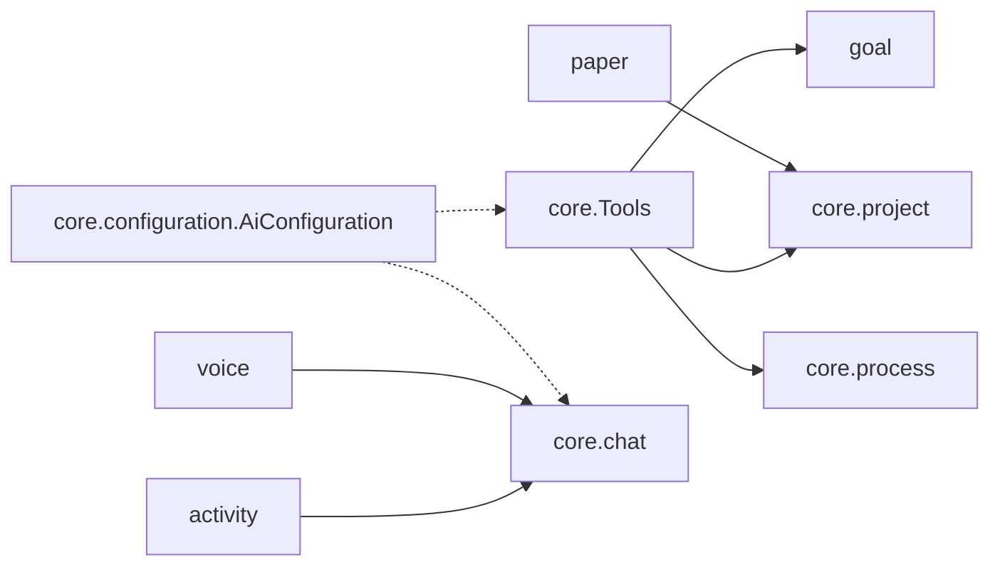
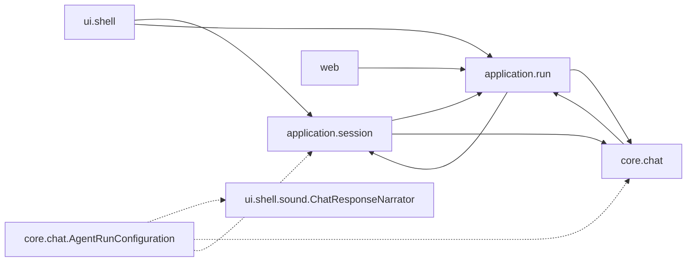
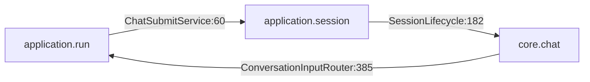
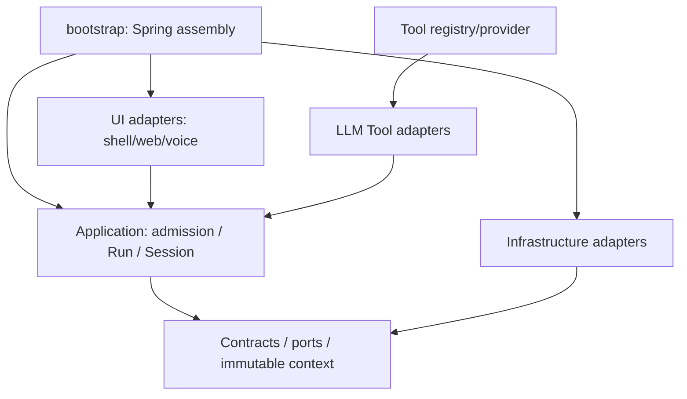

# パッケージ構成改善 Phase 0

目的は現状の記録と依存悪化の検出です。本番Java、API、ツール公開仕様、CLI契約は変更しません。
分析対象は `bb4f49247370ed3e6cd9cc3ee06209aa060e5075` の本番コードです。
テストのソース件数はPhase 0追加分を含みます。

- [全パッケージ統計・Configuration配置・依存集中](package-dependencies.md)
- [循環の強連結成分と全方向の代表クラス](dependency-cycles.md)
- [coreの責務分類](core-responsibilities.md)
- [Toolsの53メソッド・説明・引数・戻り値・共有状態](tools-analysis.md)
- [Phase 1〜5の移行計画](migration-roadmap.md)
- [機械可読集計](data/summary.json)、[全ソース](data/sources.tsv)、[パッケージ辺](data/package-edges.tsv)

## 再現方法

JDK 25、既存Maven Wrapper、Python 3.10以上（標準ライブラリのみ）を使用します。
依存解析はArchUnit 1.4.2のbytecode解析、ソース集計はJDKのjavac ASTです。
JUnit Jupiterから通常の`@Test`として呼ぶため、JUnit 6と別のテストengineを重ねません。
[ArchUnit公式ドキュメント](https://www.archunit.org/userguide/html/000_Index.html)も参照してください。

PowerShell（`-D`は引用符で囲む）:

```powershell
./mvnw.cmd clean
./mvnw.cmd -B "-Dtest=PackageArchitectureTest,ArchitectureGuardTest,ArchitectureSourceReportTest" "-Darchitecture.report=true" test
python scripts/report-architecture.py --source-commit bb4f49247370ed3e6cd9cc3ee06209aa060e5075
```

POSIXでは`./mvnw`に置き換えます。将来の再計測は`--source-commit HEAD`を指定します。
指定SHAはラベルであり、そのコミットをcheckoutする機能ではありません。必ず対象のcheckoutで実行してください。
ソースの改変有無はsummaryの正規化済みSHA-256でも確認できます。
`clean`により古い移動済みクラスを除去してから測定します。
`target/architecture/dependencies.tsv`にクラス依存と行番号付き証拠、`classes.tsv`に本番bytecodeクラス、
`sources.tsv`にソース種別、`tools.tsv`・`tools-fields.tsv`にツールとフィールドを出力します。
`type-sizes.tsv`にjavac ASTによる各クラスの宣言spanを出力し、ファイル全体の行数とは区別します。
大きなraw bytecodeレポートはGitへ追加せず、CI artifactに保存します。
同じ入力TSVとSHAでPythonを再実行すると、コミットするMarkdown・TSV・JSONは同一になります。

通常の検証:

```powershell
./mvnw.cmd -B test
./mvnw.cmd -B -Pfull test
./mvnw.cmd -B -DskipTests package
./mvnw.cmd -B -f terminal/pom.xml verify
```

### Phase 0で確認した検証（2026-10-22）

| 検証 | 結果 |
| --- | --- |
| 全JUnit回帰（既存のfull分類、live除外） | 6,072件、failure/error 0、既存条件によるskip 5 |
| 最終アーキテクチャ・既存fixture修正の対象テスト | 14件成功 |
| クラスspanを含むjavacレポート | 専用テスト成功、再生成結果がバイト一致 |
| 新規UI違反を実際のproduction出力へ一時追加 | ゲート失敗を確認後、一時class/sourceを削除 |
| 既存辺削除・予算縮小 | 通常モードは縮小要求で失敗、明示縮小は成功 |
| CI環境で予算更新を指定 | 明示的に拒否 |
| backend package / terminal verify | 成功。CLIは126件、failure/error/skip 0 |
| Checkstyle / SpotBugsの既存負債ゲート | 新規0件（既存SpotBugs 1,907件は保持） |

全回帰は専用の`rei.build.directory`と`test.dataDirectory`で実行しました。
全件を初回実行した際の既存の不足Beanは、上流`b84b6ca1`と同一のfixture修正で解消しています。
CIの最終結果はPRのチェックを参照してください。

## CIのゲートとベースライン

`PackageArchitectureTest`は既定テストにもfullにも含まれます。Java regression CIは専用ステップでも
`ArchitectureGuardTest`と合わせて実行し、レポートをartifactに保存します。

| ID | 監視対象 | 初期クラス辺数 |
| --- | --- | --- |
| A | 処理本体のapplication → ui/web | 0 |
| B | run/session/chat/stagnation/execution/checkpoint/process → ui/web | 1 |
| C-business | 機能境界間の処理本体の循環に参加する全クラス辺 | 2837 |
| C-wiring | Configurationを含む循環の配線辺と、配線があるときだけ循環する処理本体の辺 | 799 |
| D | Configurationを依存元とする機能間の辺 | 372 |
| E | core外 → coreへの辺（wiring/businessの区別付き） | 1034 |

`core`と`application`は直下サブパッケージ単位、他はトップレベル機能単位に分けます。
例えば`core.chat`と`core.project`、`application.run`と`application.session`は別境界です。
詳細package単位の循環もレポートします。Configurationという名前や配置されたpackage全体を例外にしません。
Configuration注釈・メタ注釈を持つクラスとその包含クラスの辺を配線として別予算にします。
`business`は非Configurationの型依存全体を指す計測上の分類で、DTO・enum・契約型も含みます。

`config/architecture/*.txt`はルールごとの**完全修飾クラス名ペア集合**です。
行番号や同じクラス辺の参照回数は固定しません。既存辺の新しいメソッドからの利用までは禁止しません。
新しいクラス辺、分類の変化、削除済み辺の再導入は失敗します。CはSCC全体を許可する方式ではないため、
既存循環の中に辺を足しても失敗します。Eは総数だけの上限ではなく参照元・先も固定します。
Dは配線を違反と断定するものではなく、横断配線の追加をレビュー可能にする予算です。
core内部の依存集中はレポートで観測し、機能間循環はCでも監視します。

FreezingArchRuleも検討しましたが、初回作成・refreeze設定による受け入れを避けるため、
ArchUnitで計測した辺に対する小さなread-only比較ゲートを採用しました。
通常テストに初期作成・拡大モードはありません。予算ファイルが無い場合も失敗します。
レポート生成は失敗時も実行し、ゲートと分離しています。

### 既存違反を解消したとき

1. 通常テストで`resolved debt`を確認します。古い予算を残すとテストは失敗します。
2. ローカルで以下を実行します。**追加が1件でもあれば、どの予算も更新しません**。
3. 差分が削除のみであることをレビューしてコミットし、通常モードを再実行します。

```powershell
./mvnw.cmd -B "-Dtest=PackageArchitectureTest" "-Darchitecture.baseline.shrink=true" test
./mvnw.cmd -B "-Dtest=PackageArchitectureTest,ArchitectureGuardTest" test
git diff -- config/architecture
```

`CI=true`の環境では縮小モードも明示的に拒否します。予算拡大が不可避なら、原因・承認・変更先Phaseを
PRで説明して個別のペアを手編集する必要があります。`target/architecture/*.txt`を無条件コピーする運用は禁止です。
初回導入ではRedの欠落エラーと生成された既存辺を確認してから初期予算を記録しました。
`ArchitectureGuardTest`は実bytecodeへの新規UI参照、3機能の循環、配線分類、
追加拒否、未作成予算拒否、明示縮小と再導入拒否を再現します。一時コードはJUnit TempDirにのみ作成します。

## 主要依存（確認した静的な辺の抜粋）

実線は処理本体、点線はConfigurationの配線。全辺を一枚の図には載せません。



## Run・Session・UIの現状



`AgentRunConfiguration`のUI参照は配線です（[import](../../src/main/java/dev/mikoto2000/rei/core/chat/AgentRunConfiguration.java#L3)）。
`SessionLifecycle`がRun例外を使い、`ChatSubmitService`がSessionLifecycleを作るため、
[SessionLifecycle:58](../../src/main/java/dev/mikoto2000/rei/application/session/SessionLifecycle.java#L58) と
[ChatSubmitService:60](../../src/main/java/dev/mikoto2000/rei/application/run/ChatSubmitService.java#L60) には処理本体の相互参照があります。

実行基盤を`core.execution`まで含めると、`BackgroundCommands`からShellの`ChatResponseNarrator`への処理本体依存が1件あります。
[BackgroundCommands:226](../../src/main/java/dev/mikoto2000/rei/core/execution/BackgroundCommands.java#L226)で完了したRunを読み上げます。
このB違反は例外除外せず予算に記録しました。Phase 4で完了通知のportとUI側の音声購読に分ける候補です。

`application.run`のRunServiceは受付・状態遷移・取消を、`application.session`は永続identityと受付境界を担います。
一方`core.chat.ChatExecutionService`もLLM実行・履歴保存・Policy接続を調整するため、
名称上のcore/applicationだけではApplication Serviceの配置が一意に決まりません。
[RunService:14](../../src/main/java/dev/mikoto2000/rei/application/run/RunService.java#L14)、
[SessionLifecycle:17](../../src/main/java/dev/mikoto2000/rei/application/session/SessionLifecycle.java#L17)、
[ChatExecutionService:473](../../src/main/java/dev/mikoto2000/rei/core/chat/ChatExecutionService.java#L473)が確認箇所です。
これは責務重複の候補との分析であり、同一業務処理が重複実装されていると断定するものではありません。

## 3境界を経由する主要な循環



これは処理本体由来です。受付のRun、所有者付きSession生成、実行ルータの状態判定が協働していると解釈できます。
Phase 4で扱い、Phase 0では修正しません。全SCCと代表クラスは[循環レポート](dependency-cycles.md)を参照してください。

## 目標の依存方向（提案）



## 調査の限界

- bytecodeが表す型・継承・呼び出し・フィールド・注釈等の依存です。実行頻度や障害リスクの測定ではありません。
- グラフはバックエンド本番出力に存在する内部クラス間が対象です。Java標準・Spring等の外部ライブラリへの辺は集計せず、Maven依存の監査とは区別します。
- 文字列によるBean名、反射、ServiceLoader、YAML、プロパティ条件、動的Tool/MCP登録、DB由来の参照は網羅しません。
- Configurationのクラス単位分類はBean登録と業務処理を厳密には分離できません。
  特に[ReiApplication](../../src/main/java/dev/mikoto2000/rei/ReiApplication.java#L46)はSpringBootApplicationとShell処理を兼ねるため、
  注釈上は配線に分類されます。これは現状の混在として記録し、UI処理を配線と誤解して一括移動しないでください。
- 行番号0はbytecode上の宣言等に位置情報がないケースです。呼び出しの証拠やソースも合わせて確認してください。
- 生成コードはソースの生成先とbytecode生成を区別します。Lombokは独立した.javaを生成しないためbytecode数に含まれます。
- 他機能の公開契約型への依存も循環に含みます。循環という事実と設計上の優先度は分けて判断します。
