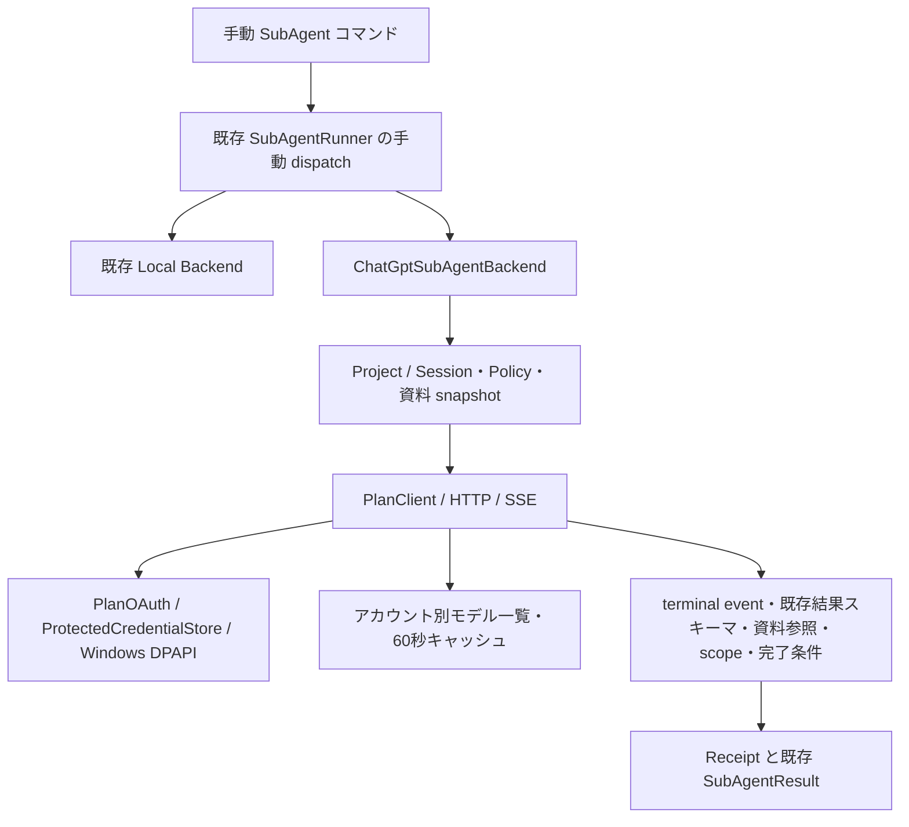

# Sign in with ChatGPT を利用する SubAgent

れいの既存ロールを `chatgpt-plan` バックエンドで手動実行する、Windows ローカル OSS 向けの機能です。通常会話、Planning Loop、`delegateTask`、並列 SubAgent、Codex / Claude Code の既存経路は従来のモデルを使います。このバックエンドを親 LLM が自動選択する Tool は追加していません。

## 利用条件と設定

公式の OSS / ローカルアプリ向けプレビューを利用します。有料またはリモートホストの提供形態は別途 OpenAI への確認が必要です。本人がブラウザで利用する ChatGPT アカウント・Workspace・利用枠へのアクセスを許可します。既存の ChatGPT 会話・記憶や Dots を取得する機能ではありません。

外部の `application.yaml` に明示的に設定します。未設定時は無効です。

```yaml
rei:
  chatgpt-plan:
    enabled: true
    allowed-roles: [reviewer]
    # 省略時: <Reiデータディレクトリ>/credentials/chatgpt-plan
    # credential-directory: C:/Users/YOU/AppData/Local/Rei/credentials/chatgpt-plan
```

既存の [reviewer](../config/subagents/reviewer.yaml) を通常の SubAgent 定義ディレクトリへ配置してください。ロール ID と結果スキーマは変えません。`roleId` は役割、`backendId` は実行先、`modelId` はアカウントのカタログで選択した slug です。`allowed-roles` が空なら外部委譲はすべて拒否します。バックエンド省略時の `/subagent run` は `local` です。ローカルモデルは従来どおりロール定義と Spring AI の既定設定で選択します。

このバックエンドの実効 Tool 権限は **0** です。ロールが持つ任意のローカル読み取り Tool も外部モデルへ渡しません。`evidenceTools` / `requiredToolCalls` / `semanticValidation` を必須とするロールは、その契約を満たせないため拒否します。外部用に検証条件を黙って無効化しません。

## 初回ログインと Phase 0 接続確認

```text
/chatgpt login --account personal
/chatgpt status
/chatgpt models --account personal
/chatgpt infer --account personal --model <表示されたslug> "Say exactly: Hello, world!"
```

`infer` は選択済み Project / Session を必要とし、`requestChatGptPlanInference` の既存 Permission / approval を適用します。

`login` が system browser を開きます。本人がアカウント選択・認証・同意を行ってください。Codex は認証を代行しません。account はローカルの登録ラベルです。異なる Workspace は異なるラベルで登録してください。同じメールアドレスでも登録を混同しません。コマンドの省略時ラベルは `default` です。

最初だけ `dynamic_agent_client` で登録を開始し、callback が返す **issued client ID** でコードを交換します。再ログインは保存した issued ID を使います。host ID は最初に生成した UUIDv4 URI を永続化し、ログアウト後も維持します。loopback listener は `127.0.0.1` の空きポートで先に起動します。state、nonce、同じ redirect URI、JWKS による RS256 署名、issuer、audience、exp、iat、sub を検証し、登録済みの subject と一致することを確認します。PKCE S256 の challenge / verifier を試行ごとに生成し、token endpoint の grant 検証に渡します。サーバーが PKCE 不一致で grant を拒否した場合は資格情報を保存しません。重複した callback パラメーターと再利用した試行は拒否します。ログイン待機は最大10分です。

ID Token の検証と推論許可は別です。token response に `chatgpt.tokens.use.direct` がなければ登録は保存しますが、推論は拒否します。認証 URL にある retained ID Token hint は表示・ログ出力しません。

## Phase 1 手動委譲

選択中の Project に属する Session を用意します。資料は Project 内の相対パスで明示してください。歴史や Working Set を自動送信しません。

```text
/subagent run reviewer --backend chatgpt-plan --account personal --model <slug> --task "この設計をレビューし、指摘と未検証事項を報告してください" --source docs/design.md --expected-result '{"unverified":[]}'
```

外部送信の承認は、role/backend/model/accountと、ロール指示文・スキーマ・タスク・実際の資料内容をまとめたdigestに結び付けます。承認後にロール定義や資料が変われば、再度承認が必要です。

`--source` は複数回指定できます。UTF-8 テキストのみです。PDF、画像、binary、隠しディレクトリ、別 Project、絶対パス、`..`、代表的な token / private key を含む資料はこの MVP では拒否します。資料をれい側で読み、参照 ID・Project 相対パス・SHA-256 を発行します。モデルへファイル読み取り権限は渡しません。必要な秘密情報を含まない資料を選ぶ責任も利用者にあります。scanner は任意の秘密情報を完全に判別する仕組みではありません。

`--expected-result` は空でない JSON object を必須とし、**既存ロールの result 内の指定フィールドとの厳密一致**を完了条件とします。例の `unverified: []` は未検証事項が残れば成功しない指定です。完了条件に合わない回答を成功にするためだけに値を緩めないでください。`--context` はローカル経路用であり、このバックエンドでは拒否します。

既存の Permission により、資料の `readFile` と外部送信の `requestChatGptPlanSubAgent` を検査します。後者の capability は `NETWORK_WRITE` と `EXTERNAL_SIDE_EFFECT` です。送信承認はタスク・資料・完了条件・モデル・アカウントの digest に結び付けます。必要な場合は既存 `/approval` で内容を確認し、承認後に同じコマンドを再実行します。ポリシーや対象資料の変更は古い承認に一致しません。声で入力した依頼への既存の追加制約も適用します。

## アーキテクチャと結果検証



外部出力は次の wrapper を使います。`subagent` には既存 envelope をそのまま入れ、その `result` をロール固有スキーマで検証します。

```json
{
  "subagent": {
    "status": "SUCCESS",
    "summary": "レビューの結論",
    "result": {"findings": [], "unverified": []},
    "warnings": []
  },
  "conclusion": "レビューの結論",
  "findings": [],
  "proposals": [],
  "references": [{"referenceId":"source-1","path":"docs/design.md","sha256":"<れいが発行したhash>","quote":"資料中の短い原文"}],
  "unverified": [],
  "scope": ["docs/design.md"]
}
```

通信正常終了 → strict JSON parsing → 既存 envelope / ロール schema → wrapper の型 → reference ID・パス・hash・原文引用 → exact scope → expected result の順に確認します。全資料への引用を必須とし、不明・重複・範囲外の参照を拒否します。conclusion は summary と一致させ、ロールの findings / unverified があれば wrapper も一致させます。SUCCESS という自己申告だけでは完了になりません。引用が一致しても論理的・実質的な正しさの証明にはなりません。MVP は別 LLM による意味検証を行いません。

Receipt には request ID、parent Run、Project、Session、role/backend/model、状態、usage、分類済みエラー、既存 SubAgentResult が含まれます。親 Run を伴う内部呼び出しは共有予約が必須です。単独 CLI は既存 standalone SubAgent 予算も適用します。従来の `delegateTask` に backend を自動付与しません。

## 制限・キャンセル・利用枠

| 項目 | 制限 |
|---|---|
| 委譲深さ | 1。子からの委譲は拒否 |
| 同時実行 | アプリプロセス内で1 |
| 推論回数 / Tool | 1 / 0 |
| 通信期限 | 原則120秒、ロールの短い期限を優先 |
| 送信 / 受信 | JSON全体256KiB / SSE全体1MiB |
| 修復 / retry / fallback | すべて無効 |

HTTP と body 読取の両方に期限を設けます。OAuth・モデルの通信にも個別期限があります。ブラウザ操作は別の10分期限です。OS credential lock 待機は最大20秒ずつです。ローカルファイルI/OやOAuth前処理はサーバー推論期限と別です。

HTTP Responses は `store=false` / `stream=true`、明示 input array、instructions を送ります。system message、`previous_response_id`、`temperature`、`top_p`、`max_output_tokens` などは禁止パラメーターとして送信しません。function tool / shell / file edit の返答を操作として実行しません。terminal response のテキストのみを使用し、delta を成功結果として保存しません。

`CREATED` / `AUTHORIZED` / `RUNNING` / `VERIFYING` の後、`COMPLETED` / `INCOMPLETE` / `FAILED` / `STOP_CONFIRMED` / `OUTCOME_UNKNOWN` を区別します。取消時には `CANCEL_REQUESTED` を発行します。送信前ならローカル停止を確認できます。送信後の取消・通信断・期限切れでは、接続を閉じてもサーバー停止は確認できないため `OUTCOME_UNKNOWN` です。store=false の HTTP に結果照会・サーバー停止確認を推測で追加していません。自動再実行しません。

既存 `/cancel` と Run cancellation の停止要求を監視します。Run 管理が CANCELLED を表示しても、それは既存のローカル取消状態であり、サーバー停止の証明ではありません。backend Receipt / SubAgent 終了イベントの OUTCOME_UNKNOWN を確認してください。`logout` も同じアカウントの実行へ停止要求を出します。

usage は terminal response の `usage.total_tokens` を共通予算に記録します。usage が不明なら null です。厳密な token 予算を持つ親は既存の usage unknown 制約に従います。送信後の unknown は予算の結果でも成功へ変更しません。API に厳密な出力 token 上限を指定できないため、これらのローカル制限はサーバー利用枠を厳密に制御しません。[ChatGPT Settings → Usage](https://chatgpt.com/settings/usage) でアプリ利用枠・credits 利用許可を確認してください。サーバー側で許可した credits の消費もあり得ます。れいは別 API キー・有料モデル・別 backend へ切り替えません。

## 資格情報・保存・ログアウト

```text
/chatgpt logout --account personal
```

current-user DPAPI を使い、access / refresh / ID Token、scope、expiry、client / subject の対応をまとめて暗号化します。Windows 以外には平文fallbackを設けません。保存先は既存 SQLite / Run データから分離します。Git 除外も設定しています。JVM lock と OS file lock の内側で load → refresh → token set 全体の atomic replace を行い、他プロセスとの refresh 競合を防ぎます。refresh 後は新しい access と replacement refresh を一緒に更新します。access token が失効した時点で更新し、先行 refresh はしません。現在資料に型が明記されていない `earliest_refresh_at` は推測解釈しません。

ログアウトは同じロックで OIDC discovery の revocation endpoint を使います。remote revoke が確認できなくてもローカルトークンは消去し、未確認であることを表示します。登録 client / verified subject と host ID を保持します。OpenAI の設定からもアプリを解除できます。別アプリ・Codex CLI の token は読みません。

prompt・SSE本文・最終結果は実行中メモリとコマンド返却のみです。prompt capture と専用 client は接続しません。RunRegistry と既存 SubAgent イベントはID・状態・固定の backend 表示を既存の保持基盤に保存します。RunRegistry の terminal retention は30分です。生HTTP本文・Authorization Header・token set はログやイベントへ渡しません。例外はapp-defined分類だけで、remote本文やraw causeを保持しません。最終本文を永続化する新しい履歴ストアは追加していません。

## エラーと復旧

| 分類 | 対処 |
|---|---|
| AUTH_REQUIRED / AUTH_INVALID | 有効な登録で本人が再ログイン。refresh invalid_grant なら古いtokenは消去 |
| CONSENT_REQUIRED | plan利用が許可されていない。本人がログイン・同意を確認 |
| MODEL_UNAVAILABLE | modelsを更新して利用可能なslugを明示選択 |
| USAGE_LIMIT | 新規推論を止め、ChatGPT Usageで制限を確認 |
| USAGE_UNAVAILABLE | 利用枠確認不能。資格情報を維持して後で本人が再確認 |
| PERMISSION_DENIED | Project・role allowlist・資料・既存approvalを確認 |
| ROUTE_UNAVAILABLE / TRANSPORT | endpointまたは通信の問題。課金先を切り替えない |
| SEND_LIMIT / RECEIVE_LIMIT | 対象資料を縮小。送信後の結果はunknownとなり得る |
| PROTOCOL / VALIDATION_FAILED | terminal・JSON・参照・完了条件を確認。自動修復なし |
| STORE_UNAVAILABLE | Windows user / DPAPI / 保存先権限・ロック・ファイル破損を確認 |

remote本文は秘密情報漏洩を避けて破棄します。そのため詳細なprovider request ID / raw error.param の保存・問い合わせ支援はまだありません。実アカウントの障害調査で必要なら、秘密情報を含めない専用診断型を追加してください。

## 既存実装調査と接続点

開始点: `origin/main` = `d3f2010e577d61e99576d52c686a00f7d52238ce`。作業中の `25bfeb7f`（Slack連携・ヘルプ日本語化）をmergeし、双方の依存・credential redactionを保持しました。

- Java25 / Spring Boot4.1.1 / Spring AI2.0.1。通常のモデルを置き換えず、専用 HTTP/SSE adapter を追加。
- SubAgentDefinition / Loader / Registry のID、モデル選択、YAMLと既存結果スキーマを維持。Runner に手動 backend dispatch を追加。既存の再試行・repair・semantic validator・parallel / DAG・Semantic Skill Search は local 経路のまま。
- Codex / Claude の ExternalAgentDelegationService / Executor はprocess実行・外部review/implementationの承認と復旧を担当する別責務。今回の純粋な推論には流用せず変更しない。
- AgentRunContext / ProjectService の明示ownership、RunRegistry、CommandCancellationService、ToolPermissionGuard、shared LlmCallReservation を再利用。Planning Loop と checkpoint resume から外部推論を自動再開しない。
- Notification は既存イベント表示基盤を使う。新しい外部通知送信なし。Request capture はSpring AI側だけで、専用clientのtokenを渡さない。

## 公式資料と検証状況

確認日: **2026-10-11 (Asia/Tokyo)**。

- [OSS/ローカル向け概要](https://developers.openai.com/siwc/token-sharing-open-source)
- [登録・sign-in](https://developers.openai.com/siwc/token-sharing-open-source/sign-in)
- [モデル・推論](https://developers.openai.com/siwc/token-sharing-open-source/models-and-inference)
- [プレビュー制限](https://developers.openai.com/siwc/token-sharing-open-source/preview-limitations)
- [Codex app-server](https://developers.openai.com/siwc/token-sharing-open-source/codex-app-server)（今回は実装しない）
- [ChatGPT利用者向け説明](https://learn.chatgpt.com/docs/sign-in-with-chatgpt)
- [アカウント・refresh・revocation](https://developers.openai.com/siwc/token-sharing-open-source/profiles-and-sessions)
- [Token reference](https://developers.openai.com/siwc/token-sharing-open-source/token-reference)
- [Errors and recovery](https://developers.openai.com/siwc/token-sharing-open-source/errors-and-recovery)
- [ID Token検証](https://developers.openai.com/siwc/website)

公開OIDC discoveryの issuer、JWKS URI、RS256、revocation endpoint を取得して確認しました。本人のOAuth・実モデル一覧・実Responses・利用枠消費・Workspace別挙動は **未検証** です。CIは実トークンを使わないモック、署名JWT、ローカルstream、Windows DPAPI、別JVM lockのテストです。認証済みAPIとの仕様差分をまだ観測していません。実アカウント接続の成功を報告していません。

ローカル検証: 最新main取り込み後の全体回帰は **4,853件、失敗0、エラー0、スキップ2**（`.github/ci/full-test.ps1`）。最後の承認digest修正は、ロール変更でもdigestが変わらない失敗を再現してから修正し、新機能59件と関連回帰で確認しています。最終headの全体検証はPRのGitHub CIでも実施します。

Phase 2候補: 親Toolへの明示backendId拡張、意味検証の設計、promptに依存しない完了条件DSL、同意付き画像/PDF入力、専用HTTP管理画面、provider診断型、未知結果を保持するcheckpoint。自律的backend選択、app-server、別processの推論workerは未実装です。
