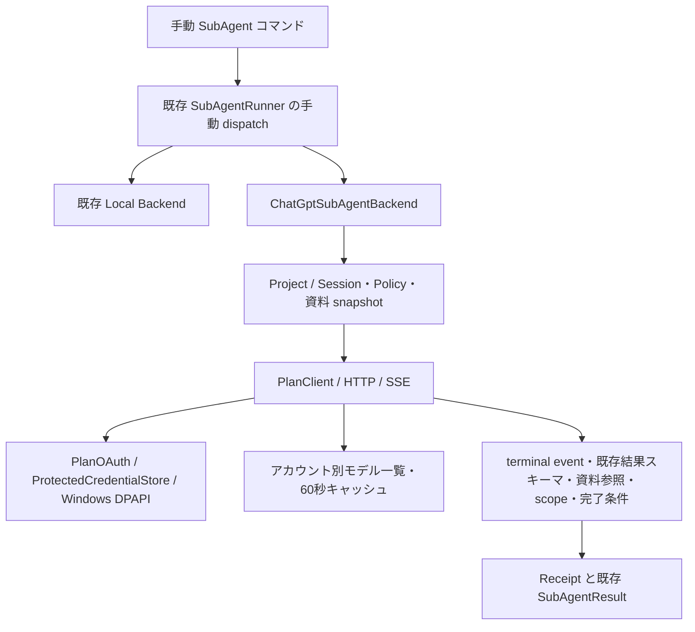

# Sign in with ChatGPT を利用する SubAgent

れいの既存ロールを `chatgpt-plan` バックエンドで手動実行する、Windows ローカル OSS 向けの機能です。通常会話、Planning Loop、バックエンドを省略した `delegateTask`、並列 SubAgent、Codex / Claude Code の既存経路は従来のモデルを使います。Phase 2では、明示設定と既存の外部送信承認の範囲内で親 LLM が `delegateTask` の接続先を指定できます。

## 利用条件と設定

公式の OSS / ローカルアプリ向けプレビューを利用します。有料またはリモートホストの提供形態は別途 OpenAI への確認が必要です。本人がブラウザで利用する ChatGPT アカウント・Workspace・利用枠へのアクセスを許可します。既存の ChatGPT 会話・記憶や Dots を取得する機能ではありません。

外部の `application.yaml` に明示的に設定します。未設定時は無効です。

```yaml
rei:
  chatgpt-plan:
    enabled: true
    allowed-roles: [reviewer]
    # 省略時: <Reiデータディレクトリ>/credentials/chatgpt-plan
    # credential-directory: C:/Users/YOU/AppData/Local/Rei/credentials/chatgpt-plan
```

既存の [reviewer](../config/subagents/reviewer.yaml) を通常の SubAgent 定義ディレクトリへ配置してください。ロール ID と結果スキーマは変えません。`roleId` は役割、`backendId` は実行先、`modelId` はアカウントのカタログで選択した slug です。`allowed-roles` が空なら外部委譲はすべて拒否します。バックエンド省略時の `/subagent run` は `local` です。ローカルモデルは従来どおりロール定義と Spring AI の既定設定で選択します。

このバックエンドの実効 Tool 権限は **0** です。ロールが持つ任意のローカル読み取り Tool も外部モデルへ渡しません。`evidenceTools` / `requiredToolCalls` / `semanticValidation` を必須とするロールは、その契約を満たせないため拒否します。外部用に検証条件を黙って無効化しません。

## 初回ログインと Phase 0 接続確認

```text
/chatgpt login --account personal
/chatgpt status
/chatgpt models --account personal
/chatgpt infer --account personal --model <表示されたslug> "Say exactly: Hello, world!"
```

`infer` は選択済み Project / Session を必要とし、`requestChatGptPlanInference` の既存 Permission / approval を適用します。

`login` が system browser を開きます。本人がアカウント選択・認証・同意を行ってください。Codex は認証を代行しません。account はローカルの登録ラベルです。異なる Workspace は異なるラベルで登録してください。同じメールアドレスでも登録を混同しません。コマンドの省略時ラベルは `default` です。

最初だけ `dynamic_agent_client` で登録を開始し、callback が返す **issued client ID** でコードを交換します。再ログインは保存した issued ID を使います。host ID は最初に生成した UUIDv4 URI を永続化し、ログアウト後も維持します。loopback listener は `127.0.0.1` の空きポートで先に起動します。state、nonce、同じ redirect URI、JWKS による RS256 署名、issuer、audience、exp、iat、sub を検証し、登録済みの subject と一致することを確認します。PKCE S256 の challenge / verifier を試行ごとに生成し、token endpoint の grant 検証に渡します。サーバーが PKCE 不一致で grant を拒否した場合は資格情報を保存しません。重複した callback パラメーターと再利用した試行は拒否します。ログイン待機は最大10分です。

ID Token の検証と推論許可は別です。token response に `chatgpt.tokens.use.direct` がなければ登録は保存しますが、推論は拒否します。認証 URL にある retained ID Token hint は表示・ログ出力しません。

## Phase 1 手動委譲

選択中の Project に属する Session を用意します。資料は Project 内の相対パスで明示してください。歴史や Working Set を自動送信しません。

```text
/subagent run reviewer --backend chatgpt-plan --account personal --model <slug> --task "この設計をレビューし、指摘と未検証事項を報告してください" --source docs/design.md --expected-result '{"unverified":[]}'
```

外部送信の承認は、role/backend/model/accountと、ロール指示文・スキーマ・タスク・実際の資料内容をまとめたdigestに結び付けます。承認後にロール定義や資料が変われば、再度承認が必要です。

`--source` は複数回指定できます。UTF-8 テキストのみです。PDF、画像、binary、隠しディレクトリ、別 Project、絶対パス、`..`、代表的な token / private key を含む資料はこの MVP では拒否します。資料をれい側で読み、参照 ID・Project 相対パス・SHA-256 を発行します。モデルへファイル読み取り権限は渡しません。必要な秘密情報を含まない資料を選ぶ責任も利用者にあります。scanner は任意の秘密情報を完全に判別する仕組みではありません。

`--expected-result` は空でない JSON object を必須とし、**既存ロールの result 内の指定フィールドとの厳密一致**を完了条件とします。例の `unverified: []` は未検証事項が残れば成功しない指定です。完了条件に合わない回答を成功にするためだけに値を緩めないでください。`--context` はローカル経路用であり、このバックエンドでは拒否します。

既存の Permission により、資料の `readFile` と外部送信の `requestChatGptPlanSubAgent` を検査します。後者の capability は `NETWORK_WRITE` と `EXTERNAL_SIDE_EFFECT` です。送信承認はタスク・資料・完了条件・モデル・アカウントの digest に結び付けます。必要な場合は既存 `/approval` で内容を確認し、承認後に同じコマンドを再実行します。ポリシーや対象資料の変更は古い承認に一致しません。声で入力した依頼への既存の追加制約も適用します。

## アーキテクチャと結果検証



外部出力は次の wrapper を使います。`subagent` には既存 envelope をそのまま入れ、その `result` をロール固有スキーマで検証します。

```json
{
  "subagent": {
    "status": "SUCCESS",
    "summary": "レビューの結論",
    "result": {"findings": [], "unverified": []},
    "warnings": []
  },
  "conclusion": "レビューの結論",
  "findings": [],
  "proposals": [],
  "references": [{"referenceId":"source-1","path":"docs/design.md","sha256":"<れいが発行したhash>","quote":"資料中の短い原文"}],
  "unverified": [],
  "scope": ["docs/design.md"]
}
```

通信正常終了 → strict JSON parsing → 既存 envelope / ロール schema → wrapper の型 → reference ID・パス・hash・原文引用 → exact scope → expected result の順に確認します。全資料への引用を必須とし、不明・重複・範囲外の参照を拒否します。conclusion は summary と一致させ、ロールの findings / unverified があれば wrapper も一致させます。SUCCESS という自己申告だけでは完了になりません。引用が一致しても論理的・実質的な正しさの証明にはなりません。MVP は別 LLM による意味検証を行いません。

Receipt には request ID、parent Run、Project、Session、role/backend/model、状態、usage、分類済みエラー、既存 SubAgentResult が含まれます。親 Run を伴う内部呼び出しは共有予約が必須です。単独 CLI は既存 standalone SubAgent 予算も適用します。従来の `delegateTask` に backend を自動付与しません。

## 制限・キャンセル・利用枠

| 項目 | 制限 |
|---|---|
| 委譲深さ | 1。子からの委譲は拒否 |
| 同時実行 | アプリプロセス内で1 |
| 推論回数 / Tool | 1 / 0 |
| 通信期限 | 原則120秒、ロールの短い期限を優先 |
| 送信 / 受信 | JSON全体256KiB / SSE全体1MiB |
| 修復 / retry / fallback | すべて無効 |

HTTP と body 読取の両方に期限を設けます。OAuth・モデルの通信にも個別期限があります。ブラウザ操作は別の10分期限です。OS credential lock 待機は最大20秒ずつです。ローカルファイルI/OやOAuth前処理はサーバー推論期限と別です。

HTTP Responses は `store=false` / `stream=true`、明示 input array、instructions を送ります。system message、`previous_response_id`、`temperature`、`top_p`、`max_output_tokens` などは禁止パラメーターとして送信しません。function tool / shell / file edit の返答を操作として実行しません。terminal response のテキストのみを使用し、delta を成功結果として保存しません。

`CREATED` / `AUTHORIZED` / `RUNNING` / `VERIFYING` の後、`COMPLETED` / `INCOMPLETE` / `FAILED` / `STOP_CONFIRMED` / `OUTCOME_UNKNOWN` を区別します。取消時には `CANCEL_REQUESTED` を発行します。送信前ならローカル停止を確認できます。送信後の取消・通信断・期限切れでは、接続を閉じてもサーバー停止は確認できないため `OUTCOME_UNKNOWN` です。store=false の HTTP に結果照会・サーバー停止確認を推測で追加していません。自動再実行しません。

既存 `/cancel` と Run cancellation の停止要求を監視します。Run 管理が CANCELLED を表示しても、それは既存のローカル取消状態であり、サーバー停止の証明ではありません。backend Receipt / SubAgent 終了イベントの OUTCOME_UNKNOWN を確認してください。`logout` も同じアカウントの実行へ停止要求を出します。

usage は terminal response の `usage.total_tokens` を共通予算に記録します。usage が不明なら null です。厳密な token 予算を持つ親は既存の usage unknown 制約に従います。送信後の unknown は予算の結果でも成功へ変更しません。API に厳密な出力 token 上限を指定できないため、これらのローカル制限はサーバー利用枠を厳密に制御しません。[ChatGPT Settings → Usage](https://chatgpt.com/settings/usage) でアプリ利用枠・credits 利用許可を確認してください。サーバー側で許可した credits の消費もあり得ます。れいは別 API キー・有料モデル・別 backend へ切り替えません。

## 資格情報・保存・ログアウト

```text
/chatgpt logout --account personal
```

current-user DPAPI を使い、access / refresh / ID Token、scope、expiry、client / subject の対応をまとめて暗号化します。Windows 以外には平文fallbackを設けません。保存先は既存 SQLite / Run データから分離します。Git 除外も設定しています。JVM lock と OS file lock の内側で load → refresh → token set 全体の atomic replace を行い、他プロセスとの refresh 競合を防ぎます。refresh 後は新しい access と replacement refresh を一緒に更新します。access token が失効した時点で更新し、先行 refresh はしません。現在資料に型が明記されていない `earliest_refresh_at` は推測解釈しません。

ログアウトは同じロックで OIDC discovery の revocation endpoint を使います。remote revoke が確認できなくてもローカルトークンは消去し、未確認であることを表示します。登録 client / verified subject と host ID を保持します。OpenAI の設定からもアプリを解除できます。別アプリ・Codex CLI の token は読みません。

prompt・SSE本文・最終結果は実行中メモリとコマンド返却のみです。prompt capture と専用 client は接続しません。RunRegistry と既存 SubAgent イベントはID・状態・固定の backend 表示を既存の保持基盤に保存します。RunRegistry の terminal retention は30分です。生HTTP本文・Authorization Header・token set はログやイベントへ渡しません。例外はapp-defined分類だけで、remote本文やraw causeを保持しません。最終本文を永続化する新しい履歴ストアは追加していません。

## エラーと復旧

| 分類 | 対処 |
|---|---|
| AUTH_REQUIRED / AUTH_INVALID | 有効な登録で本人が再ログイン。refresh invalid_grant なら古いtokenは消去 |
| CONSENT_REQUIRED | plan利用が許可されていない。本人がログイン・同意を確認 |
| MODEL_UNAVAILABLE | modelsを更新して利用可能なslugを明示選択 |
| USAGE_LIMIT | 新規推論を止め、ChatGPT Usageで制限を確認 |
| USAGE_UNAVAILABLE | 利用枠確認不能。資格情報を維持して後で本人が再確認 |
| PERMISSION_DENIED | Project・role allowlist・資料・既存approvalを確認 |
| ROUTE_UNAVAILABLE / TRANSPORT | endpointまたは通信の問題。課金先を切り替えない |
| SEND_LIMIT | 対象資料を縮小。送信後の結果はunknownとなり得る |
| RECEIVE_LIMIT | operationと本文上限を確認。modelsは2 MiB、OAuthは64 KiB、推論SSEは1 MiB。送信後の結果はunknownとなり得る |
| PROTOCOL / VALIDATION_FAILED | terminal・JSON・参照・完了条件を確認。自動修復なし |
| STORE_UNAVAILABLE | Windows user / DPAPI / 保存先権限・ロック・ファイル破損を確認 |

remote本文は秘密情報漏洩を避けて破棄します。HTTP失敗では操作・status・正規化したmedia type・観測した本文バイト数・上限・既知のAPIエラーコードだけを表示します。request ID / raw error.param / 未知のエラーコードは表示・保存しません。

## 既存実装調査と接続点

開始点: `origin/main` = `d3f2010e577d61e99576d52c686a00f7d52238ce`。作業中の `25bfeb7f`（Slack連携・ヘルプ日本語化）をmergeし、双方の依存・credential redactionを保持しました。

- Java25 / Spring Boot4.1.1 / Spring AI2.0.1。通常のモデルを置き換えず、専用 HTTP/SSE adapter を追加。
- SubAgentDefinition / Loader / Registry のID、モデル選択、YAMLと既存結果スキーマを維持。Runner に手動 backend dispatch を追加。既存の再試行・repair・semantic validator・parallel / DAG・Semantic Skill Search は local 経路のまま。
- Codex / Claude の ExternalAgentDelegationService / Executor はprocess実行・外部review/implementationの承認と復旧を担当する別責務。今回の純粋な推論には流用せず変更しない。
- AgentRunContext / ProjectService の明示ownership、RunRegistry、CommandCancellationService、ToolPermissionGuard、shared LlmCallReservation を再利用。Planning Loop と checkpoint resume から外部推論を自動再開しない。
- Notification は既存イベント表示基盤を使う。新しい外部通知送信なし。Request capture はSpring AI側だけで、専用clientのtokenを渡さない。

## 公式資料と検証状況

確認日: **2026-10-11 (Asia/Tokyo)**。

- [OSS/ローカル向け概要](https://developers.openai.com/siwc/token-sharing-open-source)
- [登録・sign-in](https://developers.openai.com/siwc/token-sharing-open-source/sign-in)
- [モデル・推論](https://developers.openai.com/siwc/token-sharing-open-source/models-and-inference)
- [プレビュー制限](https://developers.openai.com/siwc/token-sharing-open-source/preview-limitations)
- [Codex app-server](https://developers.openai.com/siwc/token-sharing-open-source/codex-app-server)（今回は実装しない）
- [ChatGPT利用者向け説明](https://learn.chatgpt.com/docs/sign-in-with-chatgpt)
- [アカウント・refresh・revocation](https://developers.openai.com/siwc/token-sharing-open-source/profiles-and-sessions)
- [Token reference](https://developers.openai.com/siwc/token-sharing-open-source/token-reference)
- [Errors and recovery](https://developers.openai.com/siwc/token-sharing-open-source/errors-and-recovery)
- [ID Token検証](https://developers.openai.com/siwc/website)

公開OIDC discoveryの issuer、JWKS URI、RS256、revocation endpoint を取得して確認しました。本人のOAuth・実モデル一覧・実Responses・利用枠消費・Workspace別挙動は **未検証** です。CIは実トークンを使わないモック、署名JWT、ローカルstream、Windows DPAPI、別JVM lockのテストです。認証済みAPIとの仕様差分をまだ観測していません。実アカウント接続の成功を報告していません。

ローカル検証: 最新main取り込み後の全体回帰は **4,853件、失敗0、エラー0、スキップ2**（`.github/ci/full-test.ps1`）。最後の承認digest修正は、ロール変更でもdigestが変わらない失敗を再現してから修正し、新機能59件と関連回帰で確認しています。最終headの全体検証はPRのGitHub CIでも実施します。

Phase 2候補: 親Toolへの明示backendId拡張、意味検証の設計、promptに依存しない完了条件DSL、同意付き画像/PDF入力、専用HTTP管理画面、provider診断型、未知結果を保持するcheckpoint。自律的backend選択、app-server、別processの推論workerは未実装です。


## モデル一覧 RECEIVE_LIMIT の調査・再検証（2026-10-11）

PR #92後の本人の診断で `operation=models, httpStatus=200, contentType=application/json, receivedBytes=262145, receiveLimitBytes=262144` が確認されました。モデルAPIのJSON応答本文が従来の256 KiB上限を超えていたことは確定しました。応答全体のサイズやJSON解析の成否は未確認です。この証拠に基づき、正常モデル一覧専用の上限を **2 MiB** に変更しました。OAuth・HTTPエラー・推論SSEの上限は変更していません。保存済み資格情報を取得せず、実アカウント通信も行っていません。

| 用途 | 本文上限 | 判定 |
|---|---:|---|
| 正常モデル一覧 JSON | 2,097,152 bytes (2 MiB) | 一致まで成功、1 byte超過で RECEIVE_LIMIT |
| models / responses のHTTPエラー本文 | 65,536 bytes (64 KiB) | 超過時もHTTP statusによる分類を保持。切れたJSONのAPIコードは推測しない |
| OAuth discovery / token更新 | 65,536 bytes (64 KiB) | 従来の制限・分類を維持。超過の診断操作を oauth-discovery / oauth-token と表示 |
| 正常推論SSE | 1,048,576 bytes (1 MiB) | 既存の累積制限を維持。SSEの改行・data等の本文フレームも含む |

モデル一覧は `ChatGptCommand.models → PlanClient.models → PlanTransport.Http → PlanIO` です。`GET https://api.openai.com/v1/models` に選択アカウントのOAuth Bearerを送信し、`Accept: application/json`、`Accept-Encoding: identity` を指定します。公式の `models` 配列から `visibility=list` の `slug` / `display_name` を順序通り取り出します。別アカウントへの切替と60秒cacheを従来通り扱います。公式資料はカタログ最大バイト数を規定していません。この上限はアプリの保護策です。

PR #92より前は256 KiB本文読み取りの後でHTTP statusを確認していたため、巨大な401/403/429/5xx本文も RECEIVE_LIMIT になっていました。修正後は非200を別経路へ分け、401=AUTH_INVALID、403=PERMISSION_DENIED、429=USAGE_LIMIT、503=ROUTE_UNAVAILABLE、その他5xx=TRANSPORTとします。完全な上限内JSONに既知の `error.code` がある場合はその分類を優先し、許可した既知コードだけ `apiErrorCode` に残します。不正・切断・非JSON本文からコードを推測しません。200はContent-TypeとContent-Encodingを確認した後で制限付き読み取り・JSON解析を行います。

受信数は `InputStream.readNBytes(limit + 1)` の実際の配列長です。UTF-8文字数、バッファ容量、HTTPヘッダーを数えていません。Content-Lengthは判定に使用せず、不明・chunkedでも実本文を数えます。圧縮は要求せず自動展開もしません。identity以外の正常応答はPROTOCOLとして停止するため、圧縮後の小さいサイズで展開後上限を回避できません。HTTPクライアントは `BodyHandlers.ofInputStream` で読み取り、本文全体を事前にbyte[]へバッファしません。上限検出用の1 byteだけ余分に読み、timeout/cancelを含めてstreamを閉じます。リダイレクトは追跡しません。

失敗コマンドには、例えば次の安全な診断が表示されます。

```text
ChatGPT plan: RECEIVE_LIMIT (operation=models, httpStatus=200, contentType=application/json, receivedBytes=2097153, receiveLimitBytes=2097152, bodyTruncated=true)
```

これは2,097,153 byteを実際に観測して停止したという意味で、応答全体のサイズではありません。読み取り前のプロトコル拒否では `receivedBytes` は出しません。未知のmedia typeは `unsupported`、欠落は `missing` とし、生ヘッダー、token、Cookie、本文、account/Workspace識別子を診断に含めません。通常の失敗表示に必要な短い診断だけを添え、常時の本文ログを追加しません。

`status` の第2フィールドは発行されたOAuth client_id（ユーザー・Workspaceに紐付く登録）、第3は検証済みID Tokenの `sub` です。tokenやclient secretではありませんが、全面表示をやめてマスクしています。authorizedは保存情報の利用スコープを示すだけで、現在のアクセストークン・モデルAPI・残利用枠の有効性を証明しません。

OAuth応答の上限超過では、操作名・status・観測65,537 byte・64 KiB上限を表示します。認証応答の分類、token refresh/rotation、資格情報の保存・消去条件は変更しません。operationがoauth-tokenの場合はmodels応答サイズとは区別してください。

これらの上限は固定値で、Spring設定バインディング・単位変換・未設定/0の解釈には依存しません。今回変更可能な受信上限設定は追加していません。`rei.chatgpt-plan.enabled`、保存先、allowed-rolesは従来通りで、外部エージェントの `max-output-bytes` 設定はこの経路に作用しません。2 MiBでも不足する場合は安全な診断で200/application/jsonのサイズ超過を確認し、別途カタログの上限・メモリ使用を評価してください。SSE上限を緩めてもモデル一覧問題は解決しません。

再検証は更新後に本人が同じmodelsコマンドを実行し、成功なら表示されたslugを確認してください。失敗なら分類、operation、httpStatus、contentType、receivedBytes、receiveLimitBytes、bodyTruncated、既知apiErrorCodeだけを共有してください。資格情報やstatusの完全識別子、本文は共有しないでください。RECEIVE_LIMITだけでは利用枠不足を証明できません。429/既知利用枠コードならChatGPT Usageを確認します。inferもモデル一覧の事前取得を行うため同じカタログ超過が起こり得ます。models成功後、本人の承認・利用枠消費を確認した上で最小のinferを実行してください。送信後の切断等は完了を保証しません。

小・256 KiB超〜2 MiB以内・2 MiB一致・+1 byteのUTF-8カタログ、Content-Lengthあり/なし・chunked、HTTP 401/403/429/500/503、巨大エラー、既知APIコード、HTML/不正JSON/Content-Type欠落/圧縮拒否、秘密情報の非表示、statusのマスクをモックで検証しています。既存SSE正常終了・サイズ超過テストも維持します。指定された概要・sign-in・モデル/推論・preview limitations・errors/recoveryの公式資料を再確認し、URL、Bearer、catalog shape、store=false/stream=trueを維持しています。実アカウントでのモデル取得・推論は引き続き未検証です。

公式 Errors and recovery はstatus・body shape・error.code / error.param・request IDの保持を推奨します。今回の安全な診断はstatusと既知コードを保持しますが、body shape / error.param / request ID / 未知コードはまだ保持しません。この診断上の差分は残ります。未知のremote文字列に個人情報・秘密情報が混入することを避けるためで、API失敗から成功への変換や課金先fallbackは行いません。


2 MiB境界の検証には、256 KiBを超える不要metadataを持つ合成JSONを使用しています。解析後のモデルcacheには `visibility=list` の `slug` と `display_name` だけを保持し、raw本文や不要metadata、解析treeを保持しません。HTTPクライアントは固定の256 KiB本文バッファを設けず、InputStreamのbackpressureを使います。ローカルHTTPサーバーからContent-Lengthありとchunked（Content-Lengthなし）の両方で2 MiBを受信・解析できること、2 MiB + 1 byteで診断付きRECEIVE_LIMITになることを検証しました。64 KiB HTTPエラー境界、1 MiB SSE完了/超過、OAuth上限と資格情報保持も回帰対象です。


## 推論時のContent-Type欠落（2026-10-11）

本人の再検証ではmodels取得に成功しました。`models` の左側は `slug`（例 `gpt-6.1-sol`）、右側は表示名です。`infer --model` には大小文字を含め左側をそのまま指定してください。`GPT-6.1-Sol` は表示名なのでMODEL_UNAVAILABLEになります。

続く推論ではHTTP 200でContent-Typeが欠落していました。従来は本文を読む前にPROTOCOLで停止したため、実際の本文がSSEだったかは未確認です。公式のモデル・推論資料は `store=false` / `stream=true` と `response.completed` の確認を要求します。Content-Type欠落が常に起こるという公式保証はありません。

HTTP 200・identity encodingでContent-Typeが欠落/空の場合だけ、1 MiB上限・既存timeout/cancelを維持して本文のSSE形式を検証します。行はdata/event/id/retry/comment/空行を検証し、dataなしの空・コメントのみ本文、JSON、HTML、不正UTF-8・JSONを成功扱いしません。成功には有効なresponse.completedが必要で、失敗・incomplete・途中切断は完了へ変換しません。明示された異なるContent-Typeやgzip等のencodingは本文読み取り前に拒否します。モデル一覧のJSON Content-Type検証も維持します。HTTP 200だけでは推論の成功を証明しません。

SSE解析がPROTOCOL/RECEIVE_LIMITで停止した場合、operation=responses・観測HTTP status・正規化Content-Type・解析器が観測したreceivedBytes・従来のreceiveLimitBytesだけを表示します。raw本文、token、request ID、個人情報は記録しません。ストリームの再送・自動retry・別課金へのfallbackは追加しません。

本人の再検証コマンド:

```text
/chatgpt infer --account personal --model gpt-6.1-sol "Say exactly: Hello, world!"
```

欠落ヘッダー付きSSEの完了・失敗・incomplete・deltaのみ、空/JSON/HTML、不正データ、明示的な異なるmedia type、圧縮拒否、1 MiB一致/超過を合成応答で確認しました。ローカルHTTPのヘッダー欠落・chunked・細分化SSEも確認しました。実アカウントの推論成功は未確認で、資格情報・実本文は使用していません。


### 完了するが本文が表示されない場合（2026-10-11）

実アカウントで `COMPLETED; usage=34; error=null` まで到達した一方、期待した本文が表示されない事例を確認しました。この表示だけでは、届いたイベントの構造は確定できません。従来のassemblerは `response.completed.response.output` のみを読み、先行するテキストイベントを破棄していました。テキストdeltaと空のterminal出力を組み合わせた人工fixtureで、同じ空表示を再現できます。

[公式SIWC推論例](https://developers.openai.com/siwc/token-sharing-open-source/models-and-inference)に従い `response.output_text.delta` をメモリ内で組み立て、`response.completed` を確認してからコマンドへ返します。出力・内容インデックス順で連結し、`response.output_text.done` と `response.output_item.done` の確定テキストは同じ部分のdeltaを置き換えるため、重複しません。非空のterminalテキストがある場合はそれを優先します。failed、incomplete、切断、timeout、cancel、受信上限超過では部分本文を公開せず、tool/未知の出力要素や不正なインデックス・テキスト型は拒否します。受信上限・OAuth・認可・再送方針は変更しません。

`/chatgpt infer` は状態表示に続いて `ChatGPT plan output:` の安全な診断を表示します。以下はすべてアプリ定義の項目と数値です。

- `terminalItems`、`message`、`reasoning`、`output_text`: 完了イベントの出力要素・内容要素の種類別件数。
- `deltaEvents`、`doneEvents`、`itemDoneEvents`、`streamParts`: テキストdelta・テキスト確定・要素確定イベントの件数と、組み立てた内容部分数。
- `streamTextLength`、`textLength`: メモリ内で組み立てた本文と返却本文のJava文字列長（UTF-16 code units）。
- `textSource`: `terminal`、`stream`、`none`。`receivedBytes`: 終了イベントまでに読み取ったバイト数。

本文は通常のコマンド結果として表示します。診断行・ResultのtoString・例外へ本文、prompt、OAuth情報、レスポンスID、remote由来の未知の種類文字列を含めず、本文を記録するloggerやファイル・イベント・履歴ストアは追加しません。本文を抽出できない場合は空行だけを返さず `completed without output text` と診断を表示します。調査時は診断行だけを共有し、本文や認証情報を貼り付ける必要はありません。

回帰テストは人工fixture、loopbackのfragmented HTTP/SSE、コマンドのShell writerで確認します。実アカウントのOAuth情報・SSE本文はテスト・ログ・Git・PRに使用しません。実環境で届いた構造と表示結果は、更新後のコマンド実行と安全な診断で確認してください。


## Phase 2: 親LLMの自動委譲

Phase 1の送信・資料snapshot・承認digest・結果検証・Run関連付けを共有します。以下は追加の管理者設定です。未設定では自動委譲は拒否し、手動経路には影響しません。

```yaml
rei:
  chatgpt-plan:
    enabled: true
    allowed-roles: [reviewer]
    auto-delegation:
      enabled: true
      allowed-accounts: [personal]
      allowed-models: [<modelsコマンドで確認したslug>]
```

親は既存 `delegateTask` の `agent` にロールを指定します。後方互換性のため `roleId` への改名はしません。

```json
{"agent":"reviewer","backendId":"chatgpt-plan","accountRef":"personal","modelId":"<slug>","task":"設計を独立レビュー","sourceRefs":["docs/design.md"],"constraints":["読み取り専用"],"completionCriteria":["未確認事項を報告"],"expectedOutput":"{\"unverified\":[]}"}
```

`expectedOutput` はPhase 1と同じ厳密一致の結果フィールド条件です。自由記述 `completionCriteria` はタスクの説明であり、機械的な完了判定の代替にはなりません。採否は親が独立して判断します。外部見解・根拠・提案・未確認事項は検証済みwrapperを含むReceipt.result.outputに返り、状態・使用量・エラー・構造/完了条件の検証エラーもReceiptに含まれます。Tool説明は親に採用・部分採用・不採用を検討し、最終回答で外部見解と自身の判断を区別するよう指示します。

バックエンド省略または `local` は従来動作です。外部専用引数をバックエンド省略で指定すること、未許可バックエンド、外部へ暗黙contextを渡すことを拒否します。親の実際のRunExecutionContextと共有予算が必須です。子から再委譲できず、同時実行は1です。モデル一覧・OAuthは実際に選んだaccountに対して既存PlanClientが確認します。

承認待ちは既存 `/approval show <id>` / 承認 / 再実行を使います。ロール指示・schema・タスク・制約・完了条件・資料snapshot・account/model変更時はdigestが変わり再評価されます。親LLMの指定は許可リストやPermissionを変更しません。失敗・取消・利用枠超過・結果不明では他モデル、別アカウント、API課金先へのfallbackはありません。

公式仕様確認日: 2026-10-11。明示履歴input、store=false、stream=true、HTTP previous_response_id禁止およびパラメーター制限は現行Phase 0/1と一致しました。公式app-serverのトークン受け渡しは子環境env_key方式と、更新後プロセス再起動・thread/resumeです。Phase 2はその別経路を追加しません。

## Phase 3: 上限付き実行・修復・比較

以下は追加の管理者設定です。execution.enabled=false（既定）ならPhase 1/2の1回推論・修復なし・同時実行1を維持します。

```yaml
rei:
  chatgpt-plan:
    execution:
      enabled: true
      max-iterations: 3
      max-repairs: 2
      refinement-rounds: 1 # 成功結果の再検討。既定0
      max-concurrent: 2
      max-input-bytes: 262144
      max-output-bytes: 1048576
      timeout: 120s
      semantic-validation: true
```

ロールYAMLの既存 `maxSteps` と `maxRepairs` も上限です。例えばmaxSteps=3、maxRepairs=2なら初回・修復・再検討を合計3回まで実行します。既存maxRepairs=0のロールは、この設定だけでは修復を許可しません。再検討回数を実行できないロールは拒否します。毎回、同じ親Runのモデル回数・token予約を消費し、総期限は延長しません。修復はJSON、schema、資料ID/引用、scope、厳密完了条件、機械的意味検証の失敗に限定します。検証条件を緩めず、修復上限・実行回数・予算のどれかで停止します。

HTTPではサーバー履歴を使いません。初回のuser JSON、前回assistant出力（最大16,384文字）、値を含まない検証診断を明示input配列へ送信します。system role、previous_response_id、conversation、max_output_tokens等は追加しません。再検討は同じモデルの自己点検であり、独立検証の代替ではありません。認証失効、取消、権限拒否、利用枠超過、通信結果不明では自動再試行しません。別アカウント・モデル・課金先にもfallbackしません。

ReceiptにはaccountRef、iterations（各推論の状態・usage・検証エラー）、既存resultのrepairAttempts/validationHistory、semanticが追加されます。semanticは独立した機械検証器で、schema/資料snapshot照合後に指摘と引用資料pathの対応、重複指摘、同一指摘の重大度の矛盾を確認します。

- SUPPORTED: 指摘の文面が照合済み引用に直接含まれる機械的裏付け。
- PARTIALLY_SUPPORTED: 引用資料と場所は対応するが、推論の妥当性は未確定。
- UNSUPPORTED: 重複・矛盾・引用資料に対応しない場所。修復対象。
- UNVERIFIED: 対応する引用資料なし。

truthVerifiedは常にfalseです。引用への文字列一致も、因果関係・一般化・「問題なし」の正しさを証明しません。自然言語の矛盾全般や自由文の完了条件を機械判定する機能ではありません。親は資料と結果を独立に評価し、追加の既存ローカルレビューを選べます。別LLMの自動検証や有料送信を新しく追加していません。既存ロールのevidenceTools/requiredToolCalls/semanticValidation契約を無効化することもありません。

既存delegateTasksへ接続先を指定できます。同じtaskの混在レビュー・複数Planモデルではcomparisonを返します。

```json
{"requests":[{"id":"local","agent":"reviewer","task":"この設計をレビュー","context":"必要な公開資料のみ"},{"id":"plan-a","agent":"reviewer","task":"この設計をレビュー","backendId":"chatgpt-plan","accountRef":"personal","modelId":"<許可slug-A>","sourceRefs":["docs/design.md"],"expectedOutput":"{\"unverified\":[]}"},{"id":"plan-b","agent":"reviewer","task":"この設計をレビュー","backendId":"chatgpt-plan","accountRef":"personal","modelId":"<許可slug-B>","sourceRefs":["docs/design.md"],"expectedOutput":"{\"unverified\":[]}"}]}
```

既存ワーカーは全体2、batch期限120秒、キュー最大8です。Plan側は設定の1〜2をさらに適用します。各Plan子はPhase 2の自動許可リスト・資料承認を通り、同じProject/Session/親Run予算へ所属します。失敗した子があっても成功した結果は保持し、全体はPARTIALまたはFAILEDです。各Plan receiptはOUTCOME_UNKNOWNや利用枠の分類も維持します。異なるtaskのbatchには比較を付けません。

comparisonは結論、JSON厳密一致の共通指摘、独自指摘、引用、未確認事項と失敗状態を区別します。多数決は行いません。ローカル結果がsnapshot引用を持たない場合は根拠比較を未解決として明記します。別Run・別モデルでも統計的独立性や正解は保証しません。

復旧時はReceiptの状態とvalidationHistoryを確認してください。INVALID outputは上限内だけ修復されます。FAILED/OUTCOME_UNKNOWN、認証・利用枠・権限エラーでは、状況を確認してから新しい依頼を選び、結果不明の再送を自動化しないでください。通常CIはmockとHTTP fixtureで実認証不要です。

## Phase 4: Codex app-server

既定無効の `codex-app-server` を明示選択できます。Windowsから既存WSL2を使用し、Linux Codex 0.154.0と動作するLinux sandboxが必要です。通常Codexのログイン・設定は使わず、Phase 0自身のaccount/tokenを使用します。対応外のバージョンは拒否します。

```yaml
rei:
  chatgpt-plan:
    enabled: true
    allowed-roles: [reviewer]
    app-server:
      enabled: true
      distribution: Ubuntu-24.04
      executable: /absolute/path/to/codex-0.154.0
      # runtime-directory: F:/project/rei/.rei/app-server
```

上記executableは利用者が用意する固定バージョンの実binaryです。自動ダウンロードや通常Codex更新は行いません。runtime-directoryはWindows上の専用作業用ディレクトリで、既定はれいのdata directory配下です。WSLから参照可能なdrive pathが必要です。

```text
/subagent run reviewer --backend codex-app-server --account personal --model <許可slug> --source docs/design.md --expected-result {"unverified":[]} --task "この設計をレビュー"
```

既存コマンドと同じtask/オプション形式を使います。自動委譲はPhase 2のauto-delegation有効化・account/model allowlistも必要です。

```json
{"agent":"reviewer","backendId":"codex-app-server","accountRef":"personal","modelId":"<許可slug>","task":"資料をレビュー","sourceRefs":["docs/design.md"],"expectedOutput":"{\"unverified\":[]}"}
```

delegateTasksも同じbackend指定でlocal/HTTP/app-serverを比較でき、部分失敗を保持します。親の実Project/Session/Run、共有予算、資料承認と検証を再利用します。app-server送信には専用requestCodexAppServerSubAgentのEXECUTE/NETWORK_WRITE/EXTERNAL_SIDE_EFFECT権限が必要です。backend・runtime・資料・modelなどの変更で承認digestも変わります。

roleがreadFile/readMultiFileを許可した場合だけ資料snapshotを取得できます。最初にmetadataを送り、native dynamic tool rei_read_sourceが各pathを一度だけ読みます。毎回親guardを検査し、続く推論回数を親の共有予算へ予約します。role.maxStepsから初回分を除いた回数と最大16読取を上限とし、usageは増分で計上します。shell、編集、任意ネットワーク、再委譲は許可しません。必要tool evidence/semantic契約を黙って省略せず、非対応なら拒否します。

Receipt.externalExecutionからopaque Thread/Turn、読取数、拒否数、イベント数、interrupt要求を確認できます。正常終端後も既存schema/引用/範囲/厳密完了条件で検証します。自由文の真偽や完了を保証せず、採否は親が判断します。

新規専用home/空workspaceを各依頼に作り、root denyの読取制限とnetwork falseを強制します。実Projectを直接mountしません。logout/期限/取消は停止要求へ反映し、停止確認できなければOUTCOME_UNKNOWNです。拒否応答は停止確認後に返し、追加推論を防ぎます。新規依頼時に既存storeでrefreshします。永続Thread resume、結果不明の自動再送、他アカウント/有料API fallbackはありません。Phase 3のHTTP修復ループはこの経路には適用しません。

既存 `/agent codex` はCLI経路で、既存の明示隔離実装・変更レビューを利用できます。app-serverは今回読取レビュー用です。認証不要の実測手順、Windows方式での以前の拒否、検証範囲は[Phase 4報告](implementation-report-chatgpt-plan-phase4.md)を参照してください。実OAuth/実モデル推論は今回代行していません。
