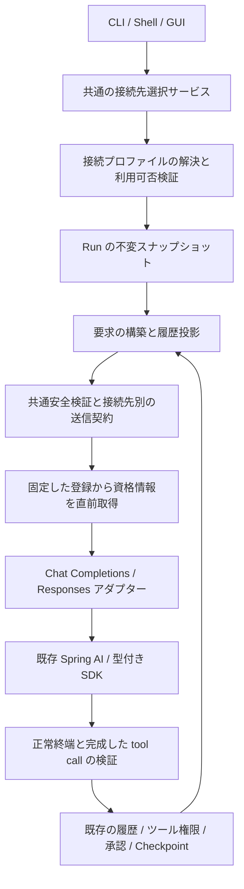

# 通常チャットの共通 LLM 接続基盤

更新日: 2026-11-26。OpenAI API、ChatGPT Plan、ローカル LLM を同じ接続基盤で扱うことを
全体の設計方針とする。既存の Responses、Run、承認、Checkpoint、動的ツール選択を再利用し、
通常チャットのエージェントループは引き続き Rei が管理する。

本文は実装の設計契約であり、機能の提供完了を示さない。
実装状況・検証結果は [実装記録](chat-endpoints-implementation.md)で区別する。
過去の [切り替え案](chat-endpoint-switching-design.md)と異なる点は本文を優先する。

## 接続プロファイルの責務

名前付きプロファイルを解決し、次の独立した情報から実効設定を作る。

| 要素 | 責務 |
| --- | --- |
| Endpoint ID / generation | 設定の登録先・世代。モデルの表示名や URL だけで同一性を判定しない |
| Provider | サーバー契約。`openai-api`、`openai-compatible`、`chatgpt-plan`。URL から推測しない |
| API | `chat-completions` / `responses`。Provider や認証とは別に選ぶ |
| Authentication | `none` / `api-key` / `chatgpt-oauth`。資格情報の参照と送信先制約を管理する |
| Model | 明示したモデル識別子。サーバーのモデルを推測しない |
| Capabilities | API / Rei アダプターの制約、サーバー、モデルの能力を交差させる |
| Replay | `encrypted` / `plaintext` / `none`。Run 受付時に固定する |
| Request settings | 明示値・継承値の由来を保持し、接続先に適用可能な値だけを選ぶ |
| Limits / timeouts | 出力・入力・ツール数・バイト数・接続 / read inactivity の限界 |
| Compatibility evidence | サーバーの版、起動設定、モデル、テンプレート、試験条件と結果 |
| Usage path | 利用者に表示するローカル / API 課金 / ChatGPT 利用枠 / 不明。通信権限を与えない |

`openai-compatible` は独立した互換サーバー契約である。URL が OpenAI のホストに一致しても
OpenAI API の契約や認証を自動適用しない。`openai-api` は公式 API の送信先制約を持ち、
任意のプロキシは互換サーバーとして明示する。Plan は既存の公式 URL に固定し、
任意の `base-url` / `api-key` を拒否する。

| Provider | API | 認証 | 共通基盤から適用する追加制約 |
| --- | --- | --- | --- |
| openai-compatible | Chat Completions / Responses | none / api-key | 指定先の検証済み機能と再送方式だけを使用 |
| openai-api | Chat Completions / Responses | api-key | 公式 API の送信先と機能・パラメーター制約 |
| chatgpt-plan | Responses | chatgpt-oauth | 公式固定送信先、アカウント登録の固定、プレビューの許可リスト |

旧来の flat 設定は互換経路として保持する。名前付き接続先に root や別 feature のキーを
暗黙継承させない。認証なしは `authentication: none` で明示し、Authorization を送らず、
dummy key も補わない。キー方式ではその接続先のキーだけを使う。
認証方式を解決できない登録は起動時の一覧から消さず、推論前に利用不可の理由を表示する。
Plan の登録に未ログインでも Rei は起動できる。設定検証や選択だけでは通信しない。

今回の `authentication` 設定は名前付き chat profile の内側で使用する。旧 flat 設定や
補助用途の静的設定に指定した場合は、項目名と対応範囲を示して拒否する。
旧経路がその指定を無視し、既定キーを送ってしまう状態を許可しない。

## 共通の処理経路

選択はサーバー全体で共有し、次の新規 Run に適用する。再起動時は設定の `active` に戻す。
選択サービスは LlmProperties や feature 単位の既存キャッシュを書き換えない。
補助推論は用途別の静的設定を解決し、通常チャットの選択を暗黙継承しない。
CLI と GUI が同じサービスを呼び、LLM や通常ツールに切り替え操作を公開しない。

Run は Provider、API、認証参照、アカウント登録識別情報、モデル、実効 Capability、
Replay、適用オプション、制限を固定する。承認後、ツール後、Checkpoint、別プロセスでの
再開も同じ設定を使う。資格情報自体を保存せず、要求直前に同一登録から取得する。
ログアウトや再登録で同一性を保証できなければ停止し、別アカウントや別接続先へ退避しない。

## ResponsesProductionPolicy の制約の分類

現行 main の固定値を全接続先に適用することも、policy 全体を解除することもしない。
旧 flat 経路の受入条件を維持したまま、次の責務へ分離する。

| 現行または必要な制約 | 分類と理由 | 共通基盤での扱い |
| --- | --- | --- |
| feature が chat / output-limit-planner、generation 1、固定 credentialRef | 現行 Rei の限定された運用構成 | 名前付き経路では解決済み登録と不変 Run を検証。任意 ID の無検証許可には置き換えない |
| OpenAI の URL、明示 API key | OpenAI API 契約・資格情報保護 | OpenAI profile に限定。互換先は自分の none / key、Plan は OAuth と固定先 |
| 明示モデル、fallback 禁止 | Rei の意図しない送信先変更防止 | 全 profile で維持 |
| 出力 2048、最大ツール 36、120 秒 | 現行 OpenAI 経路の受入試験で固定した運用条件。Responses 全体の必須値ではない | 実測・契約試験に裏付けられた profile の上限へ拡張するまでは旧経路を維持 |
| encrypted 固定 | 現行 OpenAI 経路の reasoning 継続・所有者照合の受入条件 | 対応先のみ適用。local の plaintext / none は同じ継続・承認・復旧保証を別途試験 |
| reasoning.effort=low / service_tier=default | 現行 OpenAI 経路の送信設定 | local に継承しない。Provider・モデルの実効条件から生成 |
| 設定全体の等値検証 | Rei の未検証構成の有効化防止 | 項目別 policy と pinned snapshot の照合に置換する。未知を許可しない |
| store=false / stream=true、system 変換、禁止フィールド、rei namespace | Plan の公開 HTTP 契約 | Plan adapter の型付き生成と最終 HTTP JSON の許可リスト試験 |
| HTTP previous_response_id 禁止、履歴の明示送信 | Rei のローカル履歴・復旧所有権。Plan も独自に禁止 | 共通安全境界で維持 |
| 正常終端、完成した引数、call ID、公開ツールとの一致 | API の transaction 整合性と Rei の実行安全性 | 全 Responses 接続先で維持。部分 delta で実行しない |
| 画像、ファイル、namespace、Structured Output、生成設定 | サーバー・モデル・API と Rei adapter の組合せ | 三状態の実効 Capability と互換試験で制限 |
| 接続 / inactivity timeout、入力・出力・バイト上限、取消 | Rei の資源制限とサーバーの運用条件 | 接続先別の有限値。usage 不明を 0 と見なさない |
| URL 検証、外部送信許可、redirect 制限、capture の秘匿 | Rei の送信・資格情報保護 | 各 profile で維持。local を理由に省略しない |

旧 policy の制約を置換する変更には、代替保証のテストとこの表の対応を記録する。
通常 chat に app-server のエージェントループを導入しない。OAuth、保護ストア、SDK、
SSE、履歴保存・ツール実行を独立して作り直さない。

## Capability と送信オプション

対応状態は `SUPPORTED` / `UNSUPPORTED` / `UNKNOWN` とする。API の表現能力はサーバーの
実装能力の証拠にならない。各層のどれかが非対応なら非対応、未確認なら実効状態も未確認。
モデルの対応宣言で、サーバー契約や Rei adapter の禁止を上書きできない。
本番で必要な機能が未確認なら、その接続先の該当機能を利用不可とする。

`server-capabilities` と `model-capabilities` は別の宣言とする。名前付き接続先で
サーバーの対応が未宣言なら未確認を初期値とし、`api: responses` や Replay の選択だけで
対応済みにしない。宣言は利用者が確認した設定情報であり、自動検出や実サーバー試験の
実施記録とは区別する。既存 flat 経路の互換性維持は、新規接続先の対応確認の代用にしない。

明示された非対応・未確認の設定は項目名と理由で拒否する。共通既定値から継承する値は
適用可否を判定し、適用しない理由を診断に残す。エラー後に項目を削って再送しない。
SDK が付与する `include` 等も対象にし、オブジェクトの確認だけでなく loopback HTTP の
シリアライズ済み JSON とヘッダーを検証する。

local Responses へ OpenAI の effort、service tier、encrypted include を無条件に送らない。
Plan にはプレビュー禁止の max_output_tokens、temperature、top_p、hosted tool などを送らない。
ツール検索は Rei の既存 `searchTools` を維持する。namespace の有無は要求スナップショットに
固定し、名前の分割や接頭辞除去で不明な namespace を解決しない。

## 再送・承認・復旧

encrypted / plaintext の payload は接続先の形式のまま保存し、根拠なく相互変換しない。
plaintext は既存の保存・アクセス・保持期間の保護を確認して有効化し、通常ログへ出さない。
none は reasoning payload を再送しない方式であり、会話本文と必要な tool call/result は保持する。
各方式でツール後、承認後、圧縮後、Checkpoint、再起動後の継続を試験する。
保証できない方式や機能はその接続先で無効化し、他の接続先まで停止させない。

接続先や API を変えた新規 Run では、確定済みテキストと完了した操作の結果を安全な
共通コンテキストへ投影する。外国の opaque payload や未完了 transaction を移植しない。
元の履歴は上書きしない。外部送信許可をツール実行権限と分離し、CONVERSATION の
推論を可能にしてもツール禁止を維持する。送信先・アカウント・具体的な送信内容に
許可を結び付ける。READ_ONLY / EXCLUSIVE の既存保証を維持する。

## Phase への反映と受入

| Phase | 共通基盤として実装する内容 |
| --- | --- |
| 0 | 現行コードと policy 分類、SDK / namespace / local Responses の技術検証 |
| 1 | 共通プロファイル、独立した Provider / API / 認証、三状態 Capability、Replay・利用可否契約 |
| 2 | 全接続先の実効設定と登録識別情報を Run に固定、キャッシュと補助用途の分離 |
| 3 | 共通選択サービス、Shell / CLI、既存 model 操作との統合 |
| 4 | 同じ Responses 基盤上の OpenAI / Plan / local の送信契約と HTTP JSON 試験 |
| 5 | none / key / OAuth の資格情報分離、登録固定、送信先、共有利用枠・同時要求制御 |
| 6 | 接続先別の Function Calling / namespace、共通の動的ツールと権限 |
| 7 | 三つの Replay の承認・Checkpoint・再開・取消・障害復旧 |
| 8 | API / Provider / Replay をまたぐ安全な履歴投影と対応入力 |
| 9 | 共通サービスを使う GUI、利用経路・認証・未確認機能・適用範囲の表示 |
| 10 | 全回帰、互換性マトリクス、設定と運用手順、全 Phase の PR / merge / CI 証拠 |

local Responses の実装・試験は Plan 認証やその利用可否に依存させない。
互換性記録にはサーバー名だけでなく、版、起動オプション、モデル、テンプレート、
Rei / SDK の版と機能別結果を保存する。fixture の契約試験と実サーバーの試験を区別する。
この設計策定時点では実サーバーと実アカウントの試験は未実施である。
設定例の URL は接続許可ではない。実試験は許可された接続先・モデル・送信内容・要求数で
行い、本番設定変更、サーバー再起動、モデル変更を含めない。
