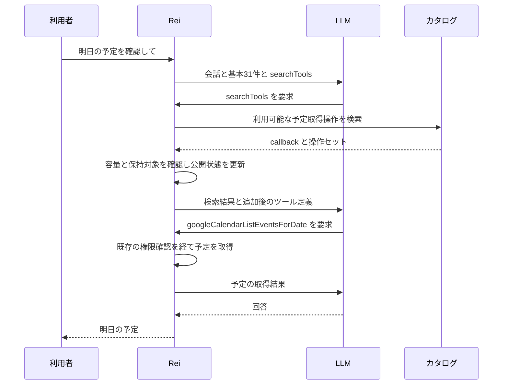

# Rei のツール検索と動的追加の設計案

作成日: 2026-11-24
状態: 設計修正と実装を実施。初期設定は無効。検証結果と有効化条件は末尾の実装状況を参照。

## 目的と採用する方式

Rei のチャットに基本31件と新設の `searchTools` を常時公開し、専門ツールは検索によってその Run に追加する。通常の新規 Run は32件で開始する。検索は Rei 内部で実行し、検索用の追加 LLM は使用しない。

既存184件は削除・統合しない。基本31件と専門153件への分類を採用し、一覧を本書の付録と同梱 CSV に固定する。API や CLI からの機能利用も維持する。基本ツールの選定は利用頻度の実測ではなく、日常の調査・編集と実行継続に必要な操作を基準にしている。

専門ツールを初めて使用する場合、LLM が検索を要求し、結果と追加定義を受け取ってから目的の操作を要求するため、最初から定義が渡されている場合より通常1往復増える。同じ Run で追加済みの操作を使う場合は再検索しない。入力トークン量や総レイテンシの改善は測定で判断する。

## 背景と調査結果

2026-11-24 02:37 の OpenAI 宛てチャットで、`Invalid 'tools': array too long` が発生した。ログには上限128件に対して184件という応答がある。失敗時と同じ起動プロセスのチャットクライアントには183件が登録され、`ReviewToolProfile.install` が `setReviewToolProfile` を1件追加する。ツール名184件に重複はなかった。過去の HTTP 本文は保存されていなかったため、同プロセスの登録状態と実行 JAR の処理を照合した結果である。

関連する現行コード:

- `src/main/java/dev/mikoto2000/rei/llm/LlmChatClientProvider.java`: 用途別クライアントとツール登録。
- `src/main/java/dev/mikoto2000/rei/core/configuration/AiConfiguration.java`: 別経路のチャットクライアント登録。
- `src/main/java/dev/mikoto2000/rei/core/chat/ChatExecutionService.java`: Run とリクエスト設定の構築。
- `src/main/java/dev/mikoto2000/rei/core/stagnation/StagnationChatModel.java`: 各反復のツール制御と実行。
- `src/main/java/dev/mikoto2000/rei/core/stagnation/ReviewToolProfile.java`: レビュー用表示制御と動的ツール追加。
- `src/main/java/dev/mikoto2000/rei/llm/StableToolDefinitions.java`: 定義の順序とスキーマの正規化。
- `src/main/java/dev/mikoto2000/rei/core/chat/ToolLoopSupport.java`: ツール実行境界。
- `src/main/java/dev/mikoto2000/rei/skills/AgentSkillImplicitSelector.java`: ツールなしのスキル選択。

## 確定する設計方針

基本31件と `searchTools` の常時公開、専門153件の分類、検索用 LLM を使わない決定的キーワード検索、検索と追加の一体実行を確定する。検索順位はツール単位で計算し、追加候補は操作セット単位で集約する。公開状態は Run ごとに独立し、接続先上限、既存権限・承認・キャンセル・イベント・結果配信を維持する。容量不足時は基本・未完了処理・現在の tool call を保護し、不要なセットを LRU で入れ替える。

検索パラメータ初期値と設定キーは下記の実装に反映する。操作セット構成と保持解除の根拠は下記の既存コード調査に基づく。新しいワークフローエンジン、汎用依存解決フレームワーク、第二の処理台帳は作らない。

OpenAI 向けのトークン引数と `chat_template_kwargs` の互換性修正は別件。本方式だけではその HTTP 400 は解消しない。

## 用語と不変条件

| 用語 | 意味 |
| --- | --- |
| 登録カタログ | Rei に実在し、現在の設定で利用可能な callback と検索用メタデータの一覧 |
| 基本ツール | 常時公開の既存31件。通常モードでは `searchTools` と合わせて32件 |
| 専門ツール | 検索・復旧によって選択した場合に公開する既存153件 |
| 操作セット | 特定の操作を開始・確認・完了・復旧するために必要な、明示定義した小さなツール集合 |
| 公開状態 | ある Run で次の LLM リクエストに載せる操作セットとバージョン |
| 保持対象 | 処理中、承認待ち、復旧待ちなどの理由で公開対象から外せない操作セット |

不変条件:

1. 検索・追加は可視性の変更であり、権限・承認・実行モード・Run の予算を増やさない。
2. 各 HTTP リクエストの最終 tools 配列は、設定した接続先の上限以内かつ名前が一意である。
3. LLM が呼べるのは、その応答を生成したリクエストの公開一覧に含まれる操作だけとする。
4. 処理を開始したら、確認・完了・取消・復旧に必要な操作を失わない。
5. 同じ callback の権限判定、イベント、結果配信属性、外部委譲の識別、予算計算を維持する。
6. 公開状態は Run ごとに分離する。共有 ChatClient の可変な既定値へ保存しない。

## 基本ツールと専門ツールの境界

基本31件には通常のファイル探索・読み書き、Web 調査、知識検索、コマンド実行、状態確認・待機・停止、作業状態、結果の続きの読み取りを含める。

専門ツールにはレビュー、外部委譲、変更セット、テスト診断、Goal、復旧、論文、予定管理、記憶の詳細などを含める。これは機能を弱める区分ではなく、モデルに定義を渡すタイミングの区分である。たとえば `checkpointResume` を専門に分類しても、復旧経路ではホストが必要な操作を事前に追加する。

検索に使う説明・別名・用途タグは管理された定義から作る。ファイル本文、Web 内容、過去会話から callback や検索メタデータを自動登録しない。無効化されている機能は検索対象にも出さない。

## searchTools の契約

初期案では、検索と追加を1つの操作で行う。検索結果から別途「ロード」を選ぶ専用ツールは設けない。これにより検索とロードだけで2往復必要になる構造を避ける。

入力例:

```json
{
  "query": "指定日のカレンダー予定を確認する",
  "maxResults": 1
}
```

| 引数 | 提案 |
| --- | --- |
| `query` | 必須。1〜256文字。自然言語の目的または正確なツール名 |
| `maxResults` | 任意。既定3、範囲1〜5。重複排除後に採用する操作セット数。ツールの検索ヒット数や依存操作を含む実際の追加件数とは別 |

`query` をコマンド、SQL、URL、動的クラス名として実行しない。検索はメモリ内のカタログだけを対象にする。初期実装は正確な名前、管理された日本語・英語の別名、用途タグ、説明文の順に重みを付けた決定的な検索とし、同点はツール名で順序を固定する。埋め込み検索は初期実装に含めない。弱い一致を無条件で採用せず、しきい値と検索事例をセットで管理する。

### ツール検索と操作セットの集約

1. 正確な名前、NFKC正規化・大小文字統一した別名、タグ、説明の固定重みで **各ツール** を採点する。日本語の分かち書きサービスやモデルを新設せず、管理された別名を使う。
2. しきい値を超える候補を、実行モード・機能・既存ポリシーで利用可能なセットへ写像する。承認待ちになり得る操作は承認を済ませた扱いにはしない。
3. 同じセット内の複数ツールが一致しても候補は1つ。セット得点は所属候補の最大値とし、ツールが多いだけで有利にならないようにする。同点は正確名一致、代表ツール名、setIdの順で決定する。
4. 集約後の上位 maxResults セットを選ぶ。既に公開済みの候補も結果に含めて冪等に扱う。大量の同セットヒットが別セットを押し出さないよう、ツール順位を固定件数で先に切らない。
5. セット依存の推移閉包をとる。共有ツールは一意なtoolIdで集合和を取り、同じsetIdの到達は1回にする。宣言した循環は強連結成分の1単位として扱い、分割追加・分割退避しない。未知の参照や非互換な同名定義はカタログ検証エラー。
6. 1検索あたりの追加上限24件は、依存展開後の toolId集合から **現在公開中のtoolId集合を引いた件数** に適用する。既に公開済みの共有ツールを再計上せず、追加と引き換えに退避する件数で相殺しない。
7. 全候補・依存を一括で RunToolAvailability に渡す。一部だけ成功させず、容量・モード・必須依存の検証が全て通れば1回の更新で確定する。

単発操作は同じ分類内でも別セットにできる。検索が追加するだけでは業務上の保持対象にしない。検索の再実行はLRUの利用順を更新できるが、集合が同じならtoolsetVersionと定義hashは変えない。

具体的な別名が一致した場合は、同じ最高得点のセットだけを候補にする。「予定」という分野語だけの一致で作成操作まで追加しないためである。実装では4文字以上の用途別名の一致（504点以上）をこの境界とする。正確な既知ツール名を指定した場合、無効な機能や権限により候補がなければ別の操作へ置き換えず一致なしを返す。論文の本文取得と節取得は `paper-content`、翻訳開始と翻訳の続き取得は `paper-translation` として各2件にまとめる。

成功時の結果例:

```json
{
  "status": "added",
  "toolsetVersion": 2,
  "matches": [{
    "tool": "googleCalendarListEventsForDate",
    "purpose": "指定日の予定を取得する"
  }],
  "added": ["googleCalendarListEventsForDate"],
  "alreadyAvailable": [],
  "removed": [],
  "activeToolCount": 33,
  "maxToolCount": 128,
  "availableFrom": "next_model_request"
}
```

結果は名前・用途・追加済み一覧・入れ替え一覧・バージョン・件数を返す。完全な JSON Schema は次のリクエストの tools 配列へ載せ、検索結果本文に二重に載せない。検索候補に挙がっただけの名前を利用可能と誤認させないよう、追加された名前を明示する。

状態は `added`、`already_available`、`no_match`、`capacity_exceeded`、`selection_too_large`、`retention_unavailable`、`unavailable`、`invalid_arguments` を区別する。`no_match` では公開状態を変えず、対応する機能が見つからなかったことを返す。既存操作の再検索は冪等とする。

## 検索から実行までの手順



各 LLM リクエストは不変の公開一覧とバージョンを持つ。LLM が同じ応答に `searchTools` と未公開の専門ツールを並べた場合は、既存 executeResumable の契約を維持し、検索を含むバッチ全体を実行前に拒否する。「検索だけを先に呼び、追加は次のリクエストから有効」と案内する。既に公開されている操作との同時呼び出しは既存の実行制御に従う。

複数の検索呼び出しは同じ Run 内で順序を固定して処理し、公開状態の更新を直列化する。すべての tool response を返してから次のリクエストを作る。検索で通常の LLM 呼び出し数・ツール数・停滞判定の予算はリセットしない。公開状態が変わっただけでユーザー目的が進んだとは判定しない。

## 操作セットと既存処理台帳

CSV の分類は用途の区分であり、操作セット ID ではない。単発の読み取りは原則1ツールのセットとし、状態を持つ経路だけを明示的にまとめる。同じツール名の重複定義は許可しないが、同じ callback が複数セットに所属することは許可する。

調査で確認した経路と、追加するセットの境界:

| セット | 構成と依存 | 正本と保持解除 |
| --- | --- | --- |
| 単一ファイル変更 | `readTextChangeSetBase`、`proposeTextChangeSet`、`inspectTextChangeSet`、`getTextChangeSetDiff`、`applyTextChangeSet`、`discardTextChangeSet`、`reconcileTextChangeSet` | `TextChangeSetService.propose/apply/discard/reconcile` と `TextChangeSetRepository`。PROPOSED、APPLYING、UNKNOWN、FAILED_UNCERTAIN は保持。APPLIED、DISCARDED、RECONCILED は解除可能。STALE は基底との差異と提案の検査を残し、未処理提案を単なる例外で捨てない |
| 文書変更 | `proposeTextDocumentChangeSet`、`inspectTextDocumentChangeSet`、`getTextDocumentChangeSetDiff`、`applyTextDocumentChangeSet`、`discardTextDocumentChangeSet`、`rollbackTextDocumentChangeSet`、`cleanTextDocumentStaging` | `TextDocumentChangeSetService.propose/inspect/apply/rollback/cleanup` の同一 journal。UNKNOWN、APPLYING、ROLLING_BACK は保持。APPLIED、ROLLED_BACK、STALE でも staging が残れば cleanup 経路を保持。phase=CLEANED または staging の不要を正本で確認して解除。DISCARDED も残存 staging を確認 |
| 診断済み修復 | `proposeDiagnosedRepair`、`inspectDiagnosedRepair`、`applyDiagnosedRepair` を同じセットとし、単一ファイル変更セットに依存。診断のみの2操作、selfReviewPatch/selfRepairPatch/changeTestImpactは同期の独立セット | `DiagnosedRepairService.propose/inspect/apply` の diagnosed_repairs と関連 Change Set。PROPOSED、STARTED、結果不明を保持。VERIFIED_CHECKS と関連変更の確定を照合。`applyDiagnosed` の guard と正確な人間の `/repair apply` は維持 |
| レガシーレビュー | `beginReview`、`restartReview`、`readReviewFile`、`readReviewPages`、`submitReviewResult`、`submitReviewPage`、`submitReviewPages`、`dismissReviewFinding`、`reviewStatus`、`reviewFindings`、`reviewPending` | `ReviewCoverageLedger.get/resume` と `ReviewTools.confirmed/requireComplete/finishRun`。未提出・STALE_VERSION は保持。COMPLETE を確認し、必要な結果の配信が完了して解除。Run の単なる終了や FAILED だけで未評価範囲を消さない |
| 永続リポジトリレビュー | `beginRepositoryReview`、`scanReviewSnapshot`、`reviewTaskStatus`、`listReviewTargets`、`listReviewTasks`、`listReviewTaskResults`、`resumeRepositoryReview`、`claimReviewWorkItem`、`readReviewWorkItem`、`readNextReviewWorkItem`、`readNextReviewWorkItems`、`submitReviewWorkItem`。既存 legacy job に連結する場合のみ上記レビューにも依存 | `ReviewTools`、`DurableTaskStore.begin/status`、work item の既存台帳。SCANNING、未完了 work item、未配信結果は保持。task の DONE と結果照合後に解除。snapshot の SEALED は列挙完了でありレビュー完了ではない |
| 外部レビュー | Codex 系の依頼・並列依頼・続行・再レビュー・修正案・取得・一覧を1セット、Claude 系の対応操作を別セットにする | `ExternalReviewRepository.start/startContinuation/get/list` の receipt。STARTED、継続中、未取得結果は保持。完了 receipt と結果取得を照合。プロセス終了だけで検証済みとしない |
| 外部実装 | `prepareCodexImplementation`、`requestCodexImplementation`、`getCodexImplementationRequest`、`getExternalImplementation`、`inspectExternalImplementation`、`recordCodexAcceptanceEvaluation` | `ImplementationRequestService.get` と `ImplementationRequestRepository.find/get/claim/finish/saveEvaluations`。AWAITING_APPROVAL、EXECUTING、VERIFYING、UNKNOWN、未評価結果を保持。RESULT_AVAILABLE は受入済みではない。評価済みの結果または確定した DENIED/FAILED を正本で照合して解除 |
| 永続サブエージェント | `delegateTask`、`delegateTasks`、`listDurableSubAgents`、`getDurableSubAgent`、`resumeSubAgent`、`reconcileSubAgent` | `DurableSubAgentRepository.get/complete/ownerLost/reconcile`。QUEUED、RUNNING、UNKNOWN、STARTED/UNKNOWN な子 operation は保持。complete が FAILED/TIMEOUT でも子 operation 不明なら UNKNOWN を維持する実装に従う |
| 依存条件 | `registerDependency`、`checkDependency`、`checkHttpDependency`、`dependencyStatus`、`dependencyHistory`、`waitForDependency`、`waitForHttpDependency`、`waitForFile`、`cancelDependency` | `PersistentDependencyRepository.createdByRun/get/terminal`。terminal は COMPLETED/FAILED/CANCELLED。親の継続で未消費の fact があれば結果受領まで保持 |
| 承認・中断・チェックポイント | 専門9件の checkpoint 操作と、保存された PendingTools に必要な各操作セットを復元 | `RunContinuation.PendingTools`、`ApprovalContinuationStore.Document`、`ApprovalContinuationService.restore`、`PersistentCheckpointService.start/resume*`。待機承認・未完了 prefix・UNKNOWN operation がある間は保持。承認取消でも成功済み兄弟操作の結果は保持し、再実行しない |

`selfReviewPatch`、`selfRepairPatch`、描画検証など同期呼び出しは、呼び出し中の保護を行い、残る receipt や変更提案があれば該当の正本に接続する。単発カレンダー・論文・フィードなどは別途の非同期処理台帳がない限り、返却完了後に架空の「未完了」フラグを作らない。ページの継続は既存配信 metadata と raw result 参照を使う。

保持情報は `(正本の種類, 所有者付きID, 必要なセットID)` の参照と、その照合結果の一時的な投影とする。RunToolAvailability に PROPOSED/RUNNING などの業務状態を複製しない。既存台帳の読取が失敗・不明の場合は保持を継続する。`TextDocumentChangeSetService.inspect` は reconcile を行うため、単なる LRU 判定から呼ばない。保持判定には同じ repository の読み取り専用 projection を狭く追加する。

処理開始直前は tool call の保護が担当し、正本への登録後は未完了処理の保持に引き継ぐ。登録失敗や結果不明で保護を先に解放しない。非同期完了イベントだけで解除せず、正本の状態と未取得結果を再照合する。任意の Project 全体の未完了処理をその Run に紐付けず、owner と既存継続の参照で対象を限定する。

## 公開数の上限と入れ替え

初期値は最終 tools 配列128件以下とする。これは今回の接続先のエラーで確認した制限に合わせた値であり、全プロバイダ共通の仕様とは扱わない。通常モードでは基本31件と `searchTools` が32枠を占め、専門用の残りは96枠となる。

検索結果は重複排除した最大5操作セット、依存展開後の新規追加ツール数は1検索あたり最大24件を初期値とする。これを超える検索は状態を変えず、目的を絞るよう案内する。分野の総件数は操作セットのサイズとは一致しない。

追加で容量を超える場合は、基本ツールと保持対象を残し、利用されていない専門の操作セットを古い順に外す。同じツールを別の操作セットも必要とする場合は外さない。利用時刻は検索での採用または有効な呼び出しで更新する。現在の応答バッチで参照されるセットは、最初のcallの前に全て実行保護し、入れ替え対象にしない。LRUは単調増加カウンタを用い、同順ならsetId順とする。要求中の新候補とその依存も同じ更新の中で退避しない。

Runの更新ロック内で、公開版・既存台帳からの保持投影・実行leaseを再確認する。台帳更新のフックとバッチ終了の保持照合も同じRun境界で直列化し、別Runの完了通知は正本照合を要求するだけとする。候補選択・依存展開・保持対象判定・入れ替え・上限検査を同一の更新として扱う。全部が収まる場合だけ確定し、失敗時は現在の公開状態を保つ。保持対象だけで容量が足りない場合は `capacity_exceeded` と不足件数を返す。処理を捨てたり、先頭128件だけを残したり、全件送信へ戻したりしない。

設定値を小さくして基本セットが収まらない場合や、必須の単一操作セットが収まらない場合は、起動・設定検証で具体的に検出する。動的追加を含め、送信直前にも重複と上限を最終検査する。重複は黙って除去せず、登録元を含む構成エラーにする。

## Run の分離と復旧

公開状態は Run の実行コンテキストが所有し、共有キャッシュには変更不能なカタログだけを置く。別 Project、Session、Run に検索結果を引き継がない。同一 Run の反復・承認待ちからの続行では維持する。新規 Run は原則32件から開始する。

復旧では、通常の履歴文章から追加対象を推測しない。信頼できる継続データに保存した操作セット ID、ツール名、定義リビジョン、保持の参照先と既存の処理台帳を照合する。保存した保持理由・終了フラグを正本にはしない。認証情報・callback 実体は保存しない。保存状態は対象 Run の所有者・Project・Session に結び付ける。

現行 ApprovalContinuationService.restore は同じ owner.runId の文書を復元する。一方 PersistentCheckpointService.resume* は原則新runIdを発行し、resumedFromRunId を使って ReviewCoverageLedger.resume などを接続する。この差を維持し、承認継続は同一Runの保存状態、checkpoint再開は明示的に引き継いだ状態のコピーから独立したRun状態を作る。

承認待ちの続行、チェックポイント、レビュー再開、非同期委譲の結果受領には、必要な操作セットを最初のモデル呼び出し前にホストが復元する。その前に所有者、catalogと定義hash、実行モード、現在の権限・機能、固定した接続先上限を再検証する。任意の過去会話に出たツール名を復元根拠としない。そのため復旧 Run の初回件数は32件を超え得るが、最終上限は守る。過去の未公開操作を自動実行することはしない。

再開時に設定無効化・ツール削除・非互換スキーマ変更があれば、別の操作に勝手に置き換えず、復旧に必要な操作が利用できないことを明示する。結果不明の外部操作も再送しない。保持対象が上限を超える場合はモデル呼び出し前に復旧を停止し、具体的な不足を表示する。

容量不足では、既に公開中の操作で処理を完了・取消できるなら、その状態を確認して保持を解除してから再検索する。検索語を狭めることで必要な追加セットが小さくなる場合も案内する。新しい Run を作るだけで未完了処理の義務や権限を回避することは認めない。復旧に必須の集合自体が上限を超える場合は自動解決できないため、対象処理の整理または対応する接続先の選択が必要な構成エラーとして扱う。

## 実行モードと他の機能との整合

| 経路 | 公開方針 |
| --- | --- |
| 通常のツール実行可能なチャット | 基本31件と検索、検索で追加した専門ツール |
| READ_ONLY | 基本・専門の両方を既存の読み取り専用ポリシーで絞る。検索もその範囲内 |
| CONVERSATION | 既存どおり tools なし。`searchTools` も送らない |
| スキル選択・抽出・要約など tools なしの処理 | 検索・基本セットを注入しない |
| 子エージェント | 親の追加済み一覧をコピーせず、子固有の許可カタログと予算から構築 |

「常時32件」は通常モードで必要な機能が利用可能な場合を指す。基本 callback 自体が利用できない構成は起動時に検証し、架空の定義を埋めない。READ_ONLY や tools なし経路は上表の例外とする。

モードによる絞り込みで必須依存が欠ける操作セットは、残りだけを不完全に公開せず、そのモードでは検索対象外にする。例えば書き込みを伴う処理の開始操作を、復旧操作だけ除いた状態で公開しない。公開時の制約に加え、実行時にも最新の権限と機能の利用可能性を検証する。

既存の `setReviewToolProfile` は専門153件の一つとして維持する。ただし全カタログを復元する権限は持たせない。レビュー表示の切り替えは「その Run に追加済みの専門ツール」だけを対象にし、基本31件と検索は通常モードで常に残す。`enabled=false` で戻る先も追加済み一覧とし、未取得の専門ツールは検索で追加する。現行の登録方法と説明文はこの契約へ変更する。

レビュー表示が有効な間は、元の表示状態を保持条件として参照し、切り替え操作自身を退避しない。検索時には現在の復旧・表示制約も確認し、次回要求に公開できないセットを追加成功と返さない。

スキル本文に専門ツール名が記載されていても、それだけで公開・許可したとは扱わない。モデルには「見えていない操作は検索し、次のリクエストから使う」と共通指示する。

## 構成要素の責務

以下は責務名であり、6個の大きなサービス基盤を必ず作る指定ではない。小さな不変 record、既存クラスのメソッド、必要なサービスにとどめる。

| 構成要素 | 入力と出力 | 所有する責務と禁止事項 |
| --- | --- | --- |
| `ToolCatalog` | 既存 callback/生成元、分類CSV相当のコード管理定義 → 一意なツール定義、別名、所属セット、明示依存、リビジョン | 不変の登録メタデータ。Run の公開状態、業務状態、認証値は持たない。状態付き `ReviewToolProfile` は Run 単位生成。未知のツール名、異なる定義の同名登録、参照切れを起動時に拒否 |
| `ToolSearchService` | query、許可・機能・モードを反映したカタログ view → ツール順位とセット順位 | 決定的検索と集合化だけ。状態の更新、callback 実行、LLM 呼び出し、権限付与はしない |
| `RunToolAvailability` | セット候補、台帳からの保持投影、実行保護、接続先上限 → 新公開状態または原子的失敗 | 下記の3状態、LRU、版番号、更新の直列化。業務台帳の代替や認証を担当しない |
| `SearchToolsCallback` | 検証した引数と信頼できる Run context → 検索・追加結果 | 既存のイベント・キャンセル・予算境界の内側で検索と1回の更新を仲介。全カタログの実行 resolver にはならない |
| `ToolRequestAssembler` | Run の固定接続先構成、公開状態、モードと復旧制約 → リクエスト固有の不変 snapshot と Prompt | 各 iteration で作成。共有 ChatClient の defaults は変更しない。履歴やtool resultを再作成しない |
| `ToolRequestValidator` | 最終 snapshot、実効 Prompt、対象接続先の上限 → 通過または具体的エラー | HTTP化直前の名前・件数・定義hash一致、raw tools 混入、未公開実行の検証。候補の勝手な削除や全件 fallback はしない |

### RunToolAvailability が区別する3つの状態

- **公開状態**: activeSetIds、LRU の単調増加カウンタ、toolsetVersion。次のリクエストを作る材料。
- **未完了処理の保持状態**: 既存処理台帳への owner 付き参照から導いた requiredSetIds。正本の状態を読んで再構築できる投影であり、独立した完了フラグは持たない。
- **実行保護状態**: requestId、toolCallId、集合としての使用セット、参照カウント。応答バッチ開始からそのバッチの保存・中断確定までの一時 lease。プロセスをまたいで lease を復元せず、PendingTools と台帳から保持状態を作り直す。

公開状態にあるだけでは保持対象ではない。逆に未完了台帳から必要と分かったセットは検索されていなくても公開状態へ復元する。現在のバッチに含まれる全ての有効な tool call を、最初の1件を実行する前に保護する。これにより先頭の検索が後続 call のセットを追い出すことを防ぐ。

### Spring AI 2.1.0 と実行ループの調査結果

`pom.xml` の spring-ai.version は **2.1.0**、Spring Boot は **4.2.0**。ローカル source JAR の pom.properties と実行 JAR 同梱ライブラリの pom.properties でも model/client-chat/openai の2.1.0を照合した。以下は「最新版」の一般論ではなく、この依存版の確認結果である。

| 既存クラスとメソッド | 確認した動作と設計への反映 |
| --- | --- |
| Spring AI `DefaultToolCallingManager.resolveToolDefinitions` | request options の callback から定義を作る。登録カタログ全体を送信対象にしない |
| 同 `resolveToolCallback` と `Builder.resolutionFallbackEnabled` | request の callback を先に検索し、名前resolverは fallback 有効時だけ呼ぶ。既定は false。本経路では明示的に false とし、外部 resolver に隠れたツールを登録しても呼べないテストを置く |
| Spring AI `OpenAiChatModel.buildRequestPrompt` | Prompt に options があればそのまま使い、なければモデル既定を使う。全件を持つ既定値を残さず、各要求で完全な options を渡す |
| 同 `getChatCompletionTools` を呼ぶリクエスト構築 | ToolCallingManager が選んだ定義が SDK の tools 配列になる。fake HTTP 接続先で最終 JSON を検証する |
| Spring AI `DefaultChatClient.prompt` と `DefaultChatClientRequestSpec.tools` | defaults のコピーと options の combine、callback/provider の蓄積がある。公開一覧を defaults に追記する方式を使わない |
| Rei `RunAwareToolCallingAdvisor.applicationOwnsTools` | RunExecutionContext を持つ要求では SDK の自動ツールループを迂回する。この契約を維持 |
| Rei `StagnationChatModel.prepare` | 現状は最初に review callback を追加し、観測 wrapper と正規化を行う。Run 固有の callback 生成・初期化は1回だけ維持する |
| Rei `StagnationChatModel.iteration` | 現状は実行後に元の prompt.getOptions を使い再帰する。公開状態を変更するだけでは次の HTTP に反映されないため、各反復で Assembler が公開状態を読み直す |
| Rei `ToolLoopSupport.executeResumable` | registeredCallback にない名前が1つでもあれば **バッチ全体を実行前に拒否** する。成功済み兄弟だけ残す既存 prefix 契約と整合させ、このバッチ拒否を維持 |
| 同 `executePendingWithinBudget` | request の callback Map で保存callとprefixを検証してから未完了分を実行。グローバルの名前解決はしない。再開時も検証済みsnapshotを渡す |
| Rei `FileReadContext.withProjection` と `StagnationChatModel.iteration` | 現在は送信されたPromptと実行用Promptを別に扱う。最終送信snapshotを実行にも使い、配信projectionだけを既存機構で引き継ぐ |

### 不変スナップショットと次回リクエストへの反映

各 HTTP 要求の直前に `(requestId, toolsetVersion, endpointRevision, catalogRevision, name→immutable definition と callback)` を確定する。`List.copyOf` だけでは callback が返す動的定義まで凍結されないため、name/description/inputSchema の値もコピーする。実行callbackは既存の guard・イベント・配信属性を保存した参照とする。

順序は、Run状態読取 → mode/resume/reviewの可視性制約 → context assembly → 定義正規化・最終検証 → snapshot確定 → HTTP送信 → 同じsnapshotで応答バッチ全体の名前検証 → 全callの実行保護 → 既存実行ループ → 結果保存・保持状態照合 → 次iterationとする。圧縮用の補助モデル呼び出しにはこのツール集合を混入させない。

検索は Run の次回用公開状態だけを更新し、現在のsnapshot・options・Mapには触れない。次iterationで新しいsnapshotを作る。`[searchTools, 未公開操作]` は既存契約どおりバッチ全体が拒否され、検索も実行しない。`[searchTools, 公開済み操作]` は両方を元snapshotで検証・保護し、順に実行できる。複数検索は応答内のcall順で原子的更新し、次HTTPは全結果を確定した後に作る。

送信タイムアウトのリトライは同じsnapshotと接続先を使い、未完のstream片や不完全な引数は実行しない。承認待ちで中断したバッチには元snapshotのツールID・定義hashを PendingTools の継続データと一緒に保存し、再開時に現在の定義と照合する。

SDK版を上げる際はこの調査を再実施する。Spring AIに独自のdispatch基盤を重ねず、既存 `ToolLoopSupport` の明示callback境界を使う。

## 設定

```yaml
rei:
  llm:
    tool-discovery:
      enabled: false
      max-active-tools: 128
      search-max-results: 3
      max-added-tools-per-search: 24
```

設定キーは `ToolDiscoveryProperties` と外部設定テンプレートに実装する。基本31件の選択と操作セットの依存関係は `tool-discovery-catalog.json` でコード管理し、任意の YAML で安全な組を分断できるようにはしない。検索結果数の指定上限5はコード側で検証する。

接続先切り替え設計との統合時には、接続先ごとの上限と本設定の小さい方を採用する。Run 中に接続先を変更しない前提を明記し、再開時には選択した接続先で容量を再検証する。

移行中の `enabled=false` は従来登録経路に戻す検証用の選択肢とするが、送信直前の上限検査は外さない。184件を許容しない接続先で全件送信を復活させる回避策にはしない。

## 観測と利用者への表示

各要求について、最終ツール件数、基本／専門件数、公開状態のバージョン、定義のハッシュ、検索時間、追加・入れ替え件数、LLM 呼び出し回数、入力トークン数、全体レイテンシを計測する。通常ログに検索文全文やスキーマ全文を出さない。診断時にはツール名・登録元と失敗理由を取得できるようにする。

画面では必要に応じて「予定取得ツールを追加」のような短い進捗を示す。検索不一致・機能無効・容量不足を区別し、内部例外本文やキーを表示しない。検索が連続して目的の操作に進まない場合も既存の Run 予算・停滞制御を適用する。

## 検証と受入条件

| 検証 | 受入条件 |
| --- | --- |
| 分類の完全性 | 既存184件を基本31件と専門153件に一度ずつ分類。未分類・重複なし |
| 初回要求 | 通常の新規 Run は基本31件と検索の32件。隠れた動的追加なし |
| 実際の HTTP 本文 | ローカルの記録用接続先で SDK が作る JSON を確認し、件数と名前を検証。実 OpenAI への送信は不要 |
| 検索品質 | 日本語・英語・正確な名前・曖昧語・一致なしを固定事例で確認。無関係な操作の過剰追加を防ぐ |
| 予定取得 | 検索の次の要求で予定取得が使え、予定作成は追加されない |
| 冪等性 | 同じ検索で重複登録や不要な状態更新が生じない |
| 実行境界 | 検索と同じ応答の未公開操作、公開されていない名前の捏造を拒否 |
| 操作セット | 変更・レビュー・委譲の開始後、確認・結果取得・復旧の経路が維持される |
| 容量 | 上限内の追加、未保持セットの入れ替え、共有依存の維持、保持対象で満杯の場合の原子的失敗 |
| 分離 | 同時 Run、Project、Session、親子エージェントで状態・権限が混ざらない |
| 復旧 | 承認待ち、ページ途中、レビュー途中、委譲結果不明、チェックポイントから必要な操作を復元 |
| 定義変更 | 再開時の機能無効化・欠落・非互換変更を検出し、自動代替や再送をしない |
| 非ツール経路 | スキル選択・要約・CONVERSATION に検索や基本セットが混入しない |
| READ_ONLY | 検索後も書き込み操作が公開・実行されない |
| レビュー表示 | 切り替えを戻しても全184件に戻らず、基本と検索は維持 |
| 既存の実行契約 | 権限、承認、イベント、結果配信、キャンセル、予算、raw tools 拒否が維持される |

性能比較は、基本操作だけの依頼、専門ツール初回、追加済み専門ツールの再利用、複数分野の長い Run の4種類で行う。呼び出し回数の増加と入力トークン削減を両方記録する。実装前には絶対時間・費用の改善率を約束しない。

## Run の接続先構成の固定

[動的エンドポイント切り替え設計](chat-endpoint-switching-design.md) と整合させる。現行 LlmModelProvider.chatModel/chatOptions と LlmChatClientProvider.chatClient は feature キャッシュ、ChatExecutionService は要求構築時に選択モデルを読むため、動的切り替えが既に実装済みとは扱わない。

Run受付時に、endpointId/configRevision、モデル、URLと生成設定、認証のサーバー内参照、タイムアウト、許可されたfallback構成、接続先のmaxToolsを1つの不変構成として確定する。モデル、クライアント、各iterationのoptions、retryは同じ構成を使い、`/llm chat use` 相当の変更は次に開始するRunだけに適用する。共有キャッシュのキーは接続先世代とモードを含む。

承認継続は元Runの構成を維持する。checkpointから新runIdで再開する場合も元実行のendpoint識別情報を引き継いで検証し、現在選択中の接続先へ黙って移さない。接続先が削除・非互換変更されていれば、利用者が再開先を明示して再検証するまで停止する。認証値は永続化せず、現在のサーバー側credential参照を解決する。

現行 FallbackChatModel.call/stream は失敗時に別モデルへ送るため、固定構成には既存の明示fallbackも含める。fallbackの候補も開始時に固定し、各送信先で上限を検証する。初期の選択枠は許可された全候補の上限の最小値とする。fallbackでtoolsを勝手に削らず、同snapshotのまま収まらなければ送信しない。

## エラー時の回復経路

| 状況 | 状態への影響と案内 |
| --- | --- |
| 検索一致なし | no_match。既存公開集合は維持。正確な操作名や別の用途語で再検索できる。シェルによる権限回避を案内しない |
| query不正・追加24件超過 | invalid_arguments / selection_too_large。変更なし。短く具体的なqueryと小さいmaxResultsを案内 |
| 容量不足 | capacity_exceeded。追加・LRU・版を全てロールバック。activeCount、requiredCount、maxCountと保護されたセットの理由を返す。既存操作の完了・取消、絞った検索、利用者による接続先再指定を案内 |
| 任意の追加済み定義が非互換 | catalog_changed。新snapshotを送信しない。現在の定義を再検索・再検証する。旧承認を新引数・新schemaの承認に流用しない |
| 保持必須の定義が非互換・機能無効 | unavailable / resume_validation_failed。保持参照は消さず、旧操作を実行しない。設定復旧または既存管理経路での明示的な処理整理が必要と表示 |
| 検索時点から無効な機能 | 無効機能のschemaや秘密の構成を公開せず、対応操作が利用できないことを返す |
| 台帳読取失敗 | retention_unavailable。保持を解除せず、追加・退避も確定しない。正本の状態を読めるようになってから再試行 |
| 接続先消失・上限不明 | Run開始・再開を停止。接続先設定と上限の明示を要求。未確認の上限を大きいと仮定しない |
| 未公開callを含む応答 | 既存のバッチ拒否。searchTools単独→次応答で目的操作という修正案内。再送による副作用はない |

## 実装の4 Phase と TDD 受入条件

全Phaseで t_wada の TDD に沿い、観測可能な振る舞いの小さな失敗テストを先に書く Red → 最小変更で通す Green → 通ったまま重複と設計を整える Refactor を繰り返す。最初から6クラスを骨組みだけ作らず、次の受入シナリオが要求した責務を抽出する。テストは実装の内部構造をなぞるだけにせず、fake clock、ローカルHTTP記録先、実際のSpring AI 2.1.0、既存SQLite repositoryを境界に使う。実OpenAIのキーと通信は不要。

### Phase 1 共通カタログと初回32件

- **Red**: CSVの184名とcallbackが一対一対応しない、同名異schema・依存参照切れ、基本欠落、上限31で起動する例を先に失敗させる。
- **Green**: 分類を維持したカタログと通常32件の要求を作る。既存Run wrapperと各callback属性はそのまま渡す。
- **受入**: 両登録経路から作った最終HTTP JSONが通常32件。CONVERSATION・スキル選択は0件、READ_ONLYはポリシーに一致。モデルdefaultsやreviewの後付けによる全件混入を検出できる。
- **Refactor**: 既存登録の重複だけを共通化し、Run状態を共有キャッシュへ持たせない。

### Phase 2 検索と動的公開

- **Red**: 同一セットの多数ヒットで別セットが消える例、検索後の次HTTPに新schemaがない例、同一応答の未公開callがresolverで実行される例を先に作る。
- **Green**: ツール採点→セット集約→依存閉包→原子的公開更新と、各iterationの不変snapshotを接続する。
- **受入**: 初回32、検索結果後の次HTTP33などを実際のJSONで確認。検索用LLM呼出し0。query別名・正確名・一致なしが決定的。同一セット集約、共有tool重複除去、循環一括化、追加数上限を確認。`[検索,未公開call]`全拒否、`[検索,公開call]`は元snapshotを保護して実行。独立Runに漏れず、registryに同名callbackを置いてもfallback経由で実行されない。
- **Refactor**: 検索計算と状態変更を分け、不要な動的DI・汎用plugin機構を作らない。

### Phase 3 操作セットの保持と復旧

- **Red**: 承認待ち・UNKNOWN・未提出レビュー・子operation不明・文書staging残存のセットがLRUで消える例、先頭検索が同バッチ後続callを退避する例、台帳読取失敗で保持解除する例を作る。
- **Green**: 正本への参照から保持を投影し、バッチleaseと分離する。保存公開状態と元snapshot識別情報を既存継続・checkpointの保存境界に含め、現在条件と照合する。
- **受入**: 未保持セットだけを決定的LRUで退避。共有toolは必要セットが残る限り保持。容量不足は集合・版・LRUを含め変更なし。完了/取消/不明の既存状態遷移に追従。承認同run、新runのcheckpoint再開、プロセス中断、成功済みprefix、定義変更、機能無効化、権限縮小、上限縮小を検証。復旧により副作用を自動再送しない。
- **Refactor**: 保存するのは公開metadataと正本参照。既存正本と同じ業務statusを持つ第二台帳を作らない。

### Phase 4 既存機能との統合と性能と回帰検証

- **Red**: endpoint切替後に進行中RunのURL/model/optionsが混ざる例、retry/fallbackだけ上限超過する例、review profile解除で全184件に戻る例を作る。
- **Green**: Run固定の接続先構成、既存resume表示制約、外部委譲・子エージェント・ページ配信・記録を統合する。
- **受入**: endpoint AのRun中に選択Bへ変更してもそのRunと承認続行はA、新規RunはB。消失構成の再開は明示失敗。許可fallback全送信で上限順守。READ_ONLY/CONVERSATIONと圧縮経路に漏れなし。権限・承認・キャンセル・イベント・結果配信・Run予算の既存回帰テストが通る。
- **性能**: 基本操作、専門初回、専門再利用、複数分野の長時間Runで、通信回数・入力token・検索時間・総レイテンシ・tool churnを旧経路と比較する。改善率の仮定で合否を決めず、追加往復と削減tokenの実測を報告する。
- **Refactor**: 重複するsnapshot生成や検証の位置を整理し、意味のある境界テストを残す。

**Phase 1・2だけでは本番の長時間Runに有効化しない。** 初期設定は無効とし、Phase 3の保持・復旧とPhase 4の回帰・性能確認を終えてから、利用者が有効化できる状態とする。段階途中での検証は隔離した短いRunとfake接続先で行う。

## Phase 4 のアーキテクチャ予算

既存の Run 実行・権限・キャンセル・配信属性・復旧台帳を再利用する実装に伴い、新設 discovery package との接続を個別ペアで記録する。[既存の更新手順](architecture/README.md) と HTTP API 機能追加時の運用に従い、生成report全体のコピーやルールの除外はしない。ユーザーが指定した既存契約の維持と、設計修正後の実装依頼を根拠とする変更である。

| 予算 | 追加 | 理由 |
| --- | ---: | --- |
| C-business | 19 | Run/観測wrapperから公開状態への接続6、配信属性の保存1、実行所有者・モード・ポリシー・Run contextへの接続8、既存review台帳への接続3、raw tools拒否の再利用1 |
| C-wiring | 1 | AiConfigurationからdiscoveryへの明示配線 |
| D-configuration | 1 | 同じ配線の個別記録 |
| E-core | 10 | 配信属性1、所有者・モード・既存Run/ポリシー8、raw tools検証1 |

A/BのUI境界は追加なし。config/architecture の既存ペアを残し、上記完全修飾名ペアだけを追加する。新規ペア拒否を検証するArchitectureGuardTestは維持する。将来 Run/権限/配信の契約をcoreから独立させる際には、その移行Phaseでこれらの循環辺も削減する。

## 採用理由と残存リスク

- キーワード検索は再現性と検索LLMの費用を優先する。自然言語の語彙差は別名辞書と固定事例で改善し、検索品質の実測が必要。
- 操作セット集約は多数の似たツールによる検索上位の占有を防ぎ、依存操作を含めた原子的追加で途中状態を避ける。
- 業務状態を既存台帳から導くことで、完了の二重管理を防ぐ。複数台帳にまたがる読み取りは一括DBトランザクションにできない場合があるため、Run境界で保護を維持し、失敗時は保持を緩めない設計が必要。
- 状態が長期間UNKNOWNの処理が多いと96専門枠を使い切る。LRUでは解決できず、人間の状態照合や処理整理が必要。
- 既存の単一ファイル提案はProject/rootスコープで、Run参照を自動列挙できない。callback結果と既存継続境界で正確なID参照を保存する必要があり、文字列の名前推測で補わない。
- snapshotで定義を凍結しても、外部サービスの利用可能性・権限は変化する。実行時検証を残し、過去の承認を拡張しない。
- 動的エンドポイント切り替えは別の未実装設計。対応APIまで本作業で暗黙に実装せず、現行の接続先も同じRun固定構成に収める。切り替え機能の実装時にここで定めた整合テストを適用する。
- Spring AI依存更新、既存callbackの状態遷移変更、新規ツール追加では分類・操作セット・保持条件の整合検査を必須にする。

## 実装状況と運用への反映

2026-11-24 に設計修正後の実装を行った。`llm/discovery` に本書の6責務と設定・保存・Run接続を置き、既存の `StagnationChatModel` の反復、承認続行、`PersistentCheckpointService.start` に接続した。分類CSVの184件、基本31件／専門153件は変更していない。

公開状態・LRU・定義hash・最後に送信した定義hash一覧・正本への参照を `tool_discovery_runs` に保存する。ここには業務statusや認証情報を保存しない。結果が不明で受付IDを取得できなかった開始操作は `操作セットID@toolCallId` という技術的な保護参照を残す。別のcallの正常終了でこの参照を消さず、IDが特定できない限り自動退避しない。取得したIDは各既存台帳の実状態で保持解除を判断する。

実装は既存設定と同じ再起動時の設定読込を前提とする。接続先のURL・モデル・timeout・実行モードの指紋を照合し、既存のfeature別モデルとfallbackインスタンスをRun中に差し替えない。動的エンドポイント選択API自体は本変更に含めない。その機能を実装する際には、前節のendpoint世代・認証参照・fallback全候補の固定契約へ拡張する必要がある。現在の `max-active-tools` は利用するprimaryとfallback双方の制限の小さい方以下に設定する（既定128、設定可能範囲1〜128）。接続先の上限をHTTPエラーから自動推測して引き上げることはしない。

カタログ外の新規ツールを自動で単発操作扱いにはしない。開始・完了・復旧の契約が不明なため、未分類登録は具体的なツール名を示して拒否する。別構成でMCP・Slack・computer-use・追加サブエージェント機能を公開する場合は、当該定義の分類とライフサイクルを追記してから有効化する。既存184件の分類変更とは別の追加レビューとする。

`enabled` の既定値は **false**。外部 `application.yaml` の変更、実行中プロセスの再起動、本番の長時間Runへの有効化は行わない。無効時も、このサービスを接続した通常Runの送信直前には件数と重複を検査し、従来の184件が設定上限を超えればローカルで明示的に停止する。

実Spring AI 2.1.0のSDKに既存クラスの実注釈から生成した定義を渡し、OkHttp interceptorでHTTP本文を記録した。件数は **184 → 32 → 33**、同一fixtureの本文UTF-8バイト数は **144,512 → 34,401 → 34,790** だった。これは同一入力における定義削減の確認であり、実エンドポイントの課金tokenや総応答時間の測定ではない。専門ツール初回の通常1往復増加も引き続き考慮する。

長時間Runの本番有効化条件は、Phase 3・4の保持・復旧・回帰受入に加え、対象接続先での4種類の実測とする。ID不明の保持、状態がUNKNOWNの処理、正本読取不能は容量不足を発生させ得る。失敗時に保持を緩める処理は実装しない。

### 実施した検証

| 検証 | 結果 |
| --- | --- |
| 分類CSV・実装カタログ・付録の照合 | 重複なし184件、基本31件／専門153件で一致 |
| Spring AIの実HTTP本文 | 実クラスのツール注釈から生成した定義で184→32→33。外部HTTP通信なし |
| 関連回帰（full分類） | 484件、failure/error/skip 0。承認、checkpoint、権限、配信、キャンセル、表示、HTTP、アーキテクチャを含む |
| 最後の上限検査変更後の再検証 | 62件、failure/error/skip 0。Run情報なしの呼出しも上限超過を拒否 |
| 最終静的解析 | Checkstyle 0件、SpotBugs XMLの指摘0件・欠落クラス0件。除外ルール追加なし |
| 台帳と不明操作 | SQLite保存・所有者照合・変更/文書staging・実外部レビュー台帳・別callで不明操作を解除しないことを検証 |

最初の全件回帰は7,690件でfailure 3、error 2、skip 12だった。新設定のテンプレート反映漏れ1件と部分Spring構成への必須注入2件を修正し、上記484件に含めて成功を確認した。既存プロセス起動の時間切れ2件も、その後の10件の再検証で全て成功した。修正後の全7,690件をもう一度実行したという意味ではない。最終コードの直接関連経路を62件で再検証している。

本番JARの再作成・配置・プロセス再起動は行っていない。検証出力は実行中のJARを含む通常のtargetを消去せず、隔離ディレクトリ `target/tool-discovery-verification-final` に作成した。

## ChatGPT へのレビュー依頼

次の前提を維持し、設計上の矛盾・不足・実装時の落とし穴をレビューしてください。

- 基本31件と `searchTools` を通常モードで常時公開する。
- 専門153件は削除せず、検索で Run に追加する。
- 検索そのものに追加 LLM を使わず、最終 HTTP リクエストの上限を守る。

重点的に確認してほしい点:

1. ツール単位検索→操作セット集約→依存閉包→LRUの順序、最大5セット・新規追加24件の件数定義は明確か。
2. 操作セットと保持対象によって、変更・承認・非同期処理・復旧の途中で必要な操作を失わないか。
3. 同一応答内の検索、並行 Run、公開状態のバージョン、入れ替えと実行の競合に穴がないか。
4. チェックポイント・レビュー・外部委譲の再開時に、権限や状態を拡張せず復元できるか。
5. 既存のレビュー表示制御、共有 ChatClient、SDK の options マージで全件が再混入しないか。
6. 基本31件と専門153件を維持したまま、操作セット境界と保持条件に不足がないか。
7. カタログ検索の精度不足や保持対象による容量不足が起きた場合に、具体的な回復経路があるか。

指摘ごとに、重要度、問題となる節、具体的な失敗シナリオ、最小限の修正案を示してください。確定前提の変更を提案する場合は、実装上必要な修正と分けて説明してください。

## 付録 184件の分類

同梱の [tool-discovery-classification.csv](tool-discovery-classification.csv) と同じ分類を以下に掲載する。件数には新設する `searchTools` を含めない。表の分野は整理用であり、その分野全体を一度に追加する指定ではない。

### 常時公開 31件

| 分野 | 件数 | ツール名 |
| --- | ---: | --- |
| 日常的な編集 | 6 | `applyTextDiff`、`copyFile`、`createDirectories`、`deleteFile`、`moveFile`、`writeMultiFile` |
| ファイル探索・読取 | 8 | `countFileLines`、`findFile`、`grepMultiQuery`、`listFile`、`readMultiFile`、`repositoryMap`、`searchAndRead`、`searchFilePage` |
| Web調査 | 3 | `fetchUrlContent`、`webSearch`、`webSearchAndRead` |
| 知識・作業文脈 | 4 | `getLastSummary`、`searchKnowledge`、`searchMemoryHistory`、`workContextGet` |
| コマンド・プロセス管理 | 5 | `getShellEnvironment`、`getShellProcessStatus`、`killShellProcess`、`runCommand`、`waitForShellProcess` |
| 日時 | 2 | `now`、`today` |
| 実行継続・結果読取 | 3 | `readRawToolResult`、`readSkillResource`、`updateTaskState` |

### 検索で追加 153件

| 分野 | 件数 | ツール名 |
| --- | ---: | --- |
| 活動履歴 | 4 | `activityBetween`、`activitySummary`、`activityTimeline`、`activityWorkInferences` |
| テスト診断・修復 | 8 | `applyDiagnosedRepair`、`changeTestImpact`、`diagnoseTestReport`、`diagnoseTestReports`、`inspectDiagnosedRepair`、`proposeDiagnosedRepair`、`selfRepairPatch`、`selfReviewPatch` |
| 変更セット | 7 | `applyTextChangeSet`、`discardTextChangeSet`、`getTextChangeSetDiff`、`inspectTextChangeSet`、`proposeTextChangeSet`、`readTextChangeSetBase`、`reconcileTextChangeSet` |
| 文書変更・描画検証 | 9 | `applyTextDocumentChangeSet`、`cleanTextDocumentStaging`、`discardTextDocumentChangeSet`、`getTextDocumentChangeSetDiff`、`inspectDocumentRender`、`inspectTextDocumentChangeSet`、`proposeTextDocumentChangeSet`、`rollbackTextDocumentChangeSet`、`validateDocumentRender` |
| Goalの証拠・工程管理 | 4 | `attachGoalCompletionEvidence`、`attachGoalStageEvidence`、`getGoalCompletionDefinition`、`proposeGoalStageSplit` |
| リポジトリレビュー | 24 | `beginRepositoryReview`、`beginReview`、`claimReviewWorkItem`、`dismissReviewFinding`、`listReviewTargets`、`listReviewTaskResults`、`listReviewTasks`、`readNextReviewWorkItem`、`readNextReviewWorkItems`、`readReviewFile`、`readReviewPages`、`readReviewWorkItem`、`restartReview`、`resumeRepositoryReview`、`reviewFindings`、`reviewPending`、`reviewStatus`、`reviewTaskStatus`、`scanReviewSnapshot`、`setReviewToolProfile`、`submitReviewPage`、`submitReviewPages`、`submitReviewResult`、`submitReviewWorkItem` |
| Bluesky投稿 | 1 | `blueskyPost` |
| 依存条件・待機 | 9 | `cancelDependency`、`checkDependency`、`checkHttpDependency`、`dependencyHistory`、`dependencyStatus`、`registerDependency`、`waitForDependency`、`waitForFile`、`waitForHttpDependency` |
| 実行スケジュール | 7 | `cancelScheduledAction`、`listScheduledActions`、`scheduleAfter`、`scheduleAt`、`scheduleCron`、`scheduleInterval`、`scheduleOnEvent` |
| チェックポイント・復旧 | 9 | `checkpointAbandon`、`checkpointAnnotate`、`checkpointConfirm`、`checkpointInspect`、`checkpointList`、`checkpointPlan`、`checkpointResume`、`checkpointSave`、`checkpointShow` |
| 文字数計算 | 1 | `countCharacters` |
| ブリーフィング | 1 | `dailyBriefing` |
| サブエージェント | 6 | `delegateTask`、`delegateTasks`、`getDurableSubAgent`、`listDurableSubAgents`、`reconcileSubAgent`、`resumeSubAgent` |
| 記憶の詳細・診断 | 3 | `episodeGet`、`episodeProcessingStatus`、`episodeSources` |
| 外部プログラム実行 | 1 | `executeExternalProgram` |
| フィード | 6 | `feedAdd`、`feedDelete`、`feedList`、`feedSummarizeBriefing`、`feedSummarizeItem`、`feedUpdate` |
| 外部エージェント連携 | 19 | `getClaudeCodeReview`、`getCodexImplementationRequest`、`getCodexReview`、`getExternalImplementation`、`inspectExternalImplementation`、`listClaudeCodeReviews`、`listCodexReviews`、`prepareCodexImplementation`、`recordCodexAcceptanceEvaluation`、`requestClaudeCodeContinueReview`、`requestClaudeCodeFixProposal`、`requestClaudeCodeReview`、`requestCodexContinueReview`、`requestCodexFixProposal`、`requestCodexImplementation`、`requestCodexReReview`、`requestCodexReview`、`requestParallelClaudeCodeReviews`、`requestParallelCodexReviews` |
| 祝日 | 2 | `getHolidayInfo`、`listHolidays` |
| 論文 | 8 | `getPaper`、`getPaperContent`、`getPaperSection`、`getPaperTranslationChunk`、`searchPaperLibrary`、`searchPapers`、`summarizePaper`、`translatePaper` |
| 要件レビュー | 4 | `getPatchRequirementReview`、`inspectPatchRequirementReview`、`listPatchRequirementReviews`、`reviewPatchRequirements` |
| カレンダー | 3 | `googleCalendarCreateEvent`、`googleCalendarListEvents`、`googleCalendarListEventsForDate` |
| 特殊ファイル入出力 | 3 | `readBinaryFile`、`readPdfFile`、`writeBinaryFile` |
| リマインダー | 2 | `reminderCreate`、`reminderList` |
| Dot連携 | 1 | `requestDotResearch` |
| 音声通知 | 1 | `soundNotify` |
| タスク管理 | 6 | `taskComplete`、`taskCreate`、`taskDelete`、`taskList`、`taskUpdate`、`taskUpdateDeadline` |
| 作業文脈の詳細・更新 | 4 | `workContextEdit`、`workContextHistory`、`workContextRevision`、`workContextUpdate` |

### 接続先能力と公開枠の分離（Responses Phase 0）

`rei.llm.max-tools` は既定接続先の明示能力、
`rei.llm.features.<feature>.max-tools` はその機能の接続先の明示能力とする。
独立custom serverには既定接続先の能力を暗黙継承しない。
能力未指定時の既存の保守的な送信上限は変更しない。
明示fallbackがある場合は候補の小さい上限を実効構成に取り込む。

`max-active-tools` は動的公開枠で、従来どおり1〜128とする。
動的選択時は公開枠と接続先能力の小さい方をRun開始・送信直前の双方で使う。
動的選択が無効でも件数・重複検証を省略しない。上限が128を超えるfake/local接続先を
利用する場合は、その能力を明示する。HTTPエラーやホスト名から上限を推測しない。

全回帰のComputerUseApplicationTestは、機能無効の全callback登録を検証するfakeモデルに
能力256件を明示した。未指定の184件送信を拒否する既存テスト、動的公開128件、
基本31件＋検索、権限・LRU・要求snapshotの契約は維持する。
